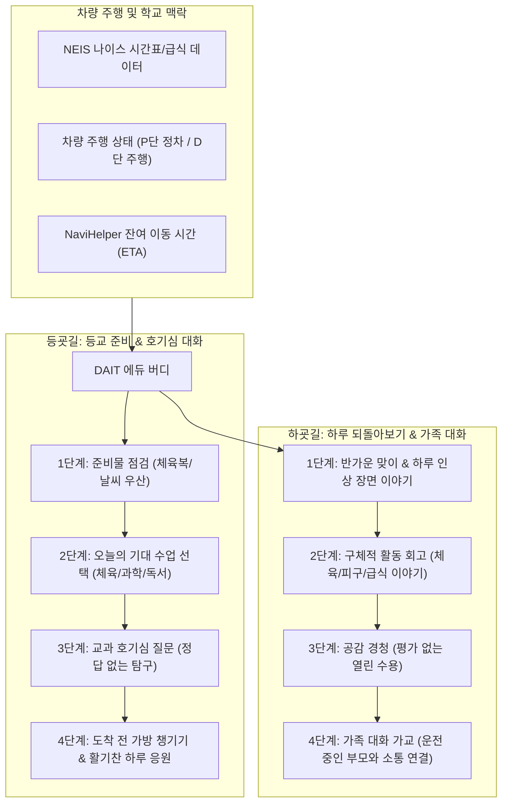

# DAIT(다잇) — 차 안에서 학교와 가정을 잇는 에듀-모빌리티 대화 서비스

> **현대자동차그룹 모빌리티 인포테인먼트 공모전 출품 기획서**  
> 서비스명: **DAIT (다잇)** — *차 안에서 학교와 가정을 잇다*  
> 타깃: 초등 자녀의 등하교를 차량으로 동행하는 보호자 및 아동  
> 핵심 가치: **차량 환경에 최적화된 온디바이스 에듀-모빌리티 버디 (Edu-Mobility Buddy)**  
> 기술 기반: Android Automotive OS, Pleos Connect SDK, On-Device Vosk Speech AI, CarUxRestrictions, NaviHelper

---

## 1. 기획 배경 및 문제 정의

### 1.1. 배경: '움직이는 제3의 공간', 등하굣길 15분의 기회
- 초등학생 자녀를 둔 많은 가정에서 매일 아침과 오후, 10~20분간 차량으로 등하교를 동행합니다.
- 차량이라는 밀폐된 공간은 부모와 아이가 나란히 앉아 교감할 수 있는 거의 유일한 일상적 공간이지만, 실제로는 두 가지 문제에 직면해 있습니다:
  1. **부모의 시선 분산 불가**: 운전자는 전방 도로에 시선을 집중해야 하므로 자녀와 눈을 맞추며 깊이 있는 대화를 나누기 어렵습니다.
  2. **수동적 미디어 노출**: 아이는 차 안에서 지루함을 달래기 위해 스마트폰 숏폼 영상이나 유튜브에 몰입하게 되어, 뇌를 깨우거나 하루를 정리할 소중한 시간을 낭비하게 됩니다.

### 1.2. 기존 음성비서의 한계와 DAIT의 차별성
- 기존 차량용 음성비서(시리, 카카오i 등)는 **명령-수행형(Command-Driven)** 비서로, "음악 틀어줘", "날씨 알려줘" 같은 일회성 도구에 불과합니다.
- 아이들에게 필요한 것은 **교육적 자극과 정서적 교감을 능동적으로 이끌어내는 '에듀 버디(Edu-Buddy)'**입니다.
- **DAIT는 학교의 공공데이터(시간표, 급식, 학사일정)와 차량 주행 맥락(목적지, ETA, 주행/정차 상태)을 융합**하여, 아이의 생각을 열어주는 맞춤형 대화 경험을 제공합니다.

---

## 2. 핵심 서비스 시나리오

### 2.1. [등굣길 모드] 등교 준비와 호기심 대화
*잠이 덜 깬 아이에게 학교생활에 대한 기대감과 호기심을 열어주는 대화*
1. **준비물 & 날씨 점검**: 오늘 시간표와 날씨를 반영해 가방 속 준비물을 부모와 함께 짧게 확인 ("오늘 체육복 챙겼나요?", "비가 와요. 우산 챙겨요!")
2. **수업 기대 질문**: "오늘 시간표에 과학과 체육이 있어요. 어떤 수업이 가장 기대돼요?"
3. **교과 연계 호기심 질문**:
   - 과학 선택 시: *"오늘 과학 시간에 무엇이 궁금해? 정답을 맞히는 질문은 아니야. 우주가 궁금할까, 아니면 실험이 기대될까?"*
   - 독서/국어 선택 시: *"최근에 읽은 이야기에서 가장 기억에 남는 주인공이나 장면이 있어?"*
4. **도착 임박 및 안전 마무리**: 학교 도착 2분 전(ETA 2분), *"도착까지 얼마 남지 않았어요. 가방과 소지품을 미리 챙겨요! 오늘도 멋진 하루 보내요."*

### 2.2. [하굣길 모드] 하루 되돌아보기 & 가족 대화 징검다리
*부모가 물으면 "그냥 그랬어"로 닫히는 대화를 자연스럽게 풀어주는 징검다리*
1. **구체적 수업/활동 트리거**: 단순한 "오늘 어땠어?" 대신 시간표를 기반으로 한 기억 소환 (*"시간표에는 체육이 있었는데, 오늘 어떤 활동을 했어? 피구 했어?"*)
2. **시간표 예외 수용**: 아이가 "오늘 체육 안 하고 만들기 했어"라고 하면 *"시간표와 다르게 수업했구나! 알려줘서 고마워. 실제로 했던 이야기를 들려줘"*라며 능동적 수용.
3. **부모에게 마이크 넘기기 (Bridge to Family)**: 아이가 신나게 자신의 일과를 털어놓은 후, *"들려줘서 고마워요. 이번에는 함께 탄 가족의 하루도 들어볼까요? 엄마/아빠는 오늘 어떤 일이 기억에 남으셨나요?"*로 토스하여 차 안의 자연스러운 가족 소통을 완성.

### 2.3. [학교 서류 간편 제출 모드] 말로 완성하는 체험학습 신청·보고서 및 결석신고서
*차량 이동 중 2~3문답 대화로 완성하여 학교로 즉시 제출하는 원스톱 교육 행정 서비스*
1. **차 안에서 음성으로 작성하는 주요 학교 행정 서류**:
   - **체험학습 결과보고서**: 체험 장소와 배운 점, 소감을 구어로 말하면 공식 결과보고서 양식으로 자동 요약 타이핑.
   - **체험학습 신청서**: 사전 탐방지, 학습 목적, 기간을 음성 대화로 구성하여 사전 승인 요청.
   - **결석신고서 (결석계)**: 질병 결석, 병원 진료, 집안 행사 등 사유와 기간을 말로 즉시 접수.
2. **실시간 공식 서식 자동 작성 & 전자 제출**:
   - 일상 구어 발화를 AI가 공식 교육 행정 문체로 실시간 요약하여 화면에 프리뷰 생성.
   - 정차(P단) 시 보호자 확인 후 원클릭으로 학교 담임선생님께 전자 결재 접수 완료. 귀가 후 복잡한 서류를 수기로 써야 하는 학부모의 부담을 차량 안에서 완전히 해소.

### 2.4. [진로·진학 모드] 최신 교육뉴스 및 학생 맞춤형 진학안내
*한국직업능력연구원 커리어넷 공공데이터 및 교육뉴스 기반 맞춤 진학·진로 가이드*
- 차 안에서 당일 수업 및 관심 분야와 연계된 미래 직업 탐색과 진로 멘토링 인터랙션 제공.
- 최신 교육 정책·입시 트렌드 및 학부모를 위한 핵심 교육 브리핑 제공.

### 2.5. [예외 및 휴식 모드] 아이의 감정 존중 (Rest & Skip)
- 아이가 피곤하거나 말을 아끼고 싶을 때 ("쉬고 싶어", "피곤해", "말하기 싫어"):
  - *"조금 쉬고 싶구나. 더 묻지 않고 조용히 함께 갈게."*라며 일체의 응답 유도나 강요 없이 조용히 마이크와 음원을 종료하고 편안한 주행 환경 제공.

---

## 3. 차량 특화 기술 및 안전 설계 (Vehicle-Native Architecture)

| 차량 기술 요소 | DAIT 구현 및 적용 방식 | 공모전 심사 포인트 |
|---|---|---|
| **CarUxRestrictions** | 주행 중(D단) 드라이버 주의 분산 방지 규정을 100% 준수. 주행 중 화면 터치 차단 및 `safety_restricted` ("주차 후 이어갈게요") 모드 전환. 정차(P단) 시에만 세부 화면 제공. | **주행 안전 최우선 정책 준수** |
| **NaviHelper (ETA 연동)** | 내비게이션 목적지가 '학교' 또는 '집'일 때 모드를 스마트하게 추천하고, 남은 시간(ETA)이 2분 이하로 줄어들면 새 질문을 중단하고 `eta_short`로 소지품 챙김 및 안전 하차 안내로 전환. | **내비게이션 컨텍스트 지능형 결합** |
| **On-Device Vosk Speech AI** | 경량화된 한국어 로컬 음성 인식 모델(Vosk)을 앱 내 탑재. 인터넷이 끊기는 터널, 지하주차장에서도 100% 동작. 아동 음성 데이터를 외부 클라우드로 전송하지 않음. | **무중단 오프라인 신뢰성 & 아동 프라이버시 완벽 보호** |
| **NEIS 및 스마트폰 동기화** | 교육부 나이스(NEIS) 학사·시간표·급식 데이터 및 모바일 컴패니언 앱 연동. 전날 저녁 스마트폰으로 알림장 숙제/준비물을 사전 확인하고, 아침 탑승 시 차량 인포테인먼트로 자동 동기화. | **모바일-차량 심리스 데이터 동기화 & 실질적 결합** |
| **오디오 포커스 (AudioFocus)** | 내비게이션 길 안내, 긴급 경고음, 블루투스 전화 수신 시 즉시 DAIT 대화를 일시 중지(`interrupt()`)하고, 상황 종료 후 안전하게 재개. | **차량 멀티미디어 생태계 표준 준수** |

---

## 4. UI/UX 디자인 원칙: 현대차 Pleos / ccNC 가이드라인 엄수

- **브랜드 아이덴티티 & 시그니처 인트로 모션 (Signature Splash Intro)**:
  - **심볼 디자인**: 차 안에서 학교와 가정을 유려하게 잇는 **원스트로크 커넥티드 리본 캘리그래피(Connected Ribbon Calligraphy)**와 'i' 상단의 시그니처 **네온 시안 도트(Cyan Dot)**. (주변 캡슐 박스 없는 순수 플로팅 엠블럼)
  - **오프닝 연출 시퀀스 (2.4초 완성)**:
    1. **한 획 드로잉 (0~1.05s)**: 딥 스페이스 네이비 배경 중앙에서 한 줄기 빛처럼 D-a-i-t 로고가 손글씨 쓰듯 유려하게 완성됨 (`stroke-dashoffset`).
    2. **시그니처 도트 임팩트 (1.12s "딱!")**: 글씨가 완성되는 찰나 'i' 위에 네온 점이 충격파 링과 함께 착지하며 맑은 사운드 큐 피드백 제공.
    3. **블루 스크린 카드 모핑 수축 & 우측 메뉴 당김 연동 (1.62s "빨려들어가기 & 캐스케이드 인")**: 전체 화면을 가득 채우던 파란색 스플래시 화면이 좌측 히어로 카드 크기로 함께 축소 수축되며 중앙의 DAIT 로고가 좌측 상단으로 빨려들어가 안착. 이와 동시에 우측 정보 카드 3단(상단 2개 미니 타일 $\rightarrow$ 학교 서류 제출 $\rightarrow$ 진로·진학 안내)이 좌측 수축 모션에 마치 당겨지듯 오른쪽에서 화면 안으로 65ms 시차를 두고 매끄럽게 슬라이드 인하여 번쩍임 없는 유기적 동역학 완성.
    4. **화면 핸드오버 (2.36s)**: 수축된 스플래시 화면이 히어로 카드와 100% 포개지며 부드럽게 핸드오버되어 실제 스마트 벤토 인터페이스 즉시 사용 가능.
    5. **언제든 리플레이 지원**: 좌측 상단 DAIT 로고 터치 시 시그니처 인트로 모션을 언제든 다시 감상 가능.
- **색상 시스템**: 현대자동차 시그니처 현대 블루 & ccNC 프리미엄 딥 네이비 톤앤매너
  - 배경: `surface (#F3F6F9)`, 카드: `paper (#FFFFFF)`, 포인트: `accent (#004DA0, 현대 블루)`
  - 히어로 그라데이션: `linear-gradient(145deg, #07172C, #0E294E, #153C70)`
  - 앰비언트 비주얼: `radial-gradient(circle, #00B4D8, #0077B6, #04244B)`
  - 텍스트: `ink (#0E1B2A)`, 보조 텍스트: `muted (#5B6D82)`, 아웃라인: `outline (#D5DFEA)`
- **시각적 군더더기 배제 & 22px 곡률 통일**:
  - 알록달록한 아동용 만화 캐릭터나 현란한 네온 효과를 철저히 배제하고, 완성도 높은 벡터 그래픽과 모든 카드(히어로 및 우측 정보 카드)의 곡률을 22px로 통일하여 조화로운 비례감 구축.
- **미니 정보 타일 (시안 3: 카드 틴트형 확정)**:
  - **준비물 · 숙제**: 쿨 블루 표면 틴트 (`background: #F4F8FD, border: #D3E4F8`) + 현대 딥 블루 텍스트 (`#004DA0`, 800 Bold)
  - **오늘 점심**: 웜 베이지 표면 틴트 (`background: #FDF9F4, border: #F6E6D5`) + 웜 테라코타 오렌지 텍스트 (`#C2410C`, 800 Bold)
  - 두 타일의 성격(준비/식단)을 은은한 컬러 틴트로 시각적으로 직관 분리하고, 본문 텍스트는 당당한 23px 800 Bold 중앙 정렬로 1초 내 인지 가능.
- **운전자 시인성**:
  - 주행 중 곁눈질로도 상태를 파악할 수 있도록 큼직한 타이포그래피(26~40sp)와 한 번에 핵심 문장 하나만 표시.
  - 음성 인식 외에도 터치 한 번으로 즉시 응답할 수 있는 대형 칩(Choice Chips) 배치.

---

## 5. 90초 시연 비디오 큐시트 (Demo Storyboard)

| 시간 | 화면 (Video) | 음성 안내 (Audio) | 시연 메시지 / 심사위원 소구 포인트 |
|---|---|---|---|
| **00:00~00:20** | 차 안 정차(P단). 솔샘초 3학년 2반 나이스 시간표(1교시 체육) 및 날씨 위젯 연동. '등교 준비' 시작. | **"오늘 학교 안내에 체육복이 있어요. 체육복 챙겼나요?"** | 차량 탑승 후 나이스 시간표/준비물 실시간 데이터 연계 입증 |
| **00:20~00:35** | 과학 수업 선택 $\rightarrow$ 호기심 탐구 질문. | **"오늘 과학 시간에 무엇이 궁금해? 정답을 맞히는 질문은 아니야."** | 단순 주입이 아닌 생각과 호기심을 여는 대화형 인터랙션 |
| **00:35~00:50** | **차량 주행(D단)** 토글 $\rightarrow$ 즉시 화면이 안전 모드("주차 후 이어갈게요")로 전환. **도착 2분 전(ETA)** 감지. | **"도착까지 얼마 남지 않았어요. 가방과 소지품을 미리 챙겨요!"** | **CarUxRestrictions 규정 준수 및 NaviHelper 잔여시간 적응형 마무리** |
| **00:50~01:05** | 하굣길 모드: 하루 활동 회고 후 부모에게 마이크 넘기기. | **"가족의 하루도 들어볼까요? 오늘도 수고했어요!"** | 차 안에서 자연스럽게 완성되는 가족 대화 가교 가치 |
| **01:05~01:30** | **학교 서류 간편 제출 카드** $\rightarrow$ "체험학습 신청 · 결과보고서 · 결석신고서" 중 말로 선택 $\rightarrow$ 화면에 나이스 공식 서식 실시간 작성 $\rightarrow$ **[학교 제출]** 버튼 터치 $\rightarrow$ 전송 완료! | **"보고서 초안이 완성되었어요! 학교로 제출할까요?"** | **차량 대화가 교육부 나이스 공식 행정 제출로 직결되는 압도적 실용성** |

---

## 6. 비즈니스 모델 및 향후 확장 계획

1. **현대차그룹 순정 인포테인먼트 빌트인 서비스**:
   - 패밀리 SUV(팰리세이드, 싼타페, 카니발, 아이오닉 등) 패밀리 고객 대상 기본 탑재 킬러 서비스로 포지셔닝.
2. **NEIS 교육행정정보시스템 정식 연동**:
   - 학부모 알림장, 주간 학습안내서 OCR 및 API 연동을 통해 전국의 모든 초등학교 맞춤형 지원.
3. **주말 패밀리 드라이브 모드 확장**:
   - 목적지가 '국립중앙박물관', '경주 유적지' 등 여행지일 경우, 이동 중 해당 지역의 역사·문화·지리 퀴즈를 제공하는 온로드 에듀테인먼트로 자연스럽게 확장.
