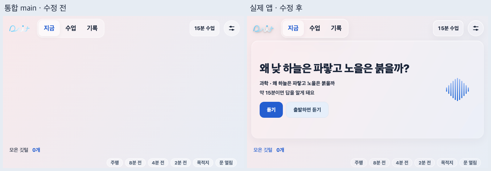
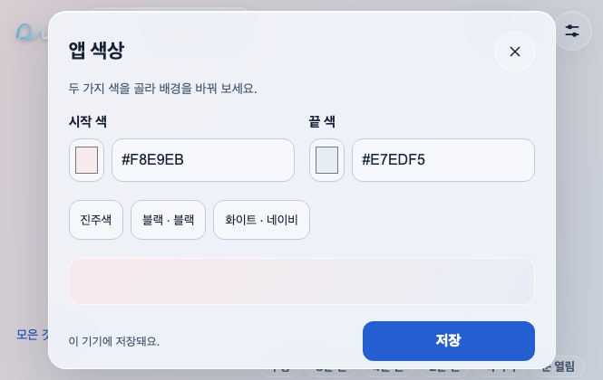
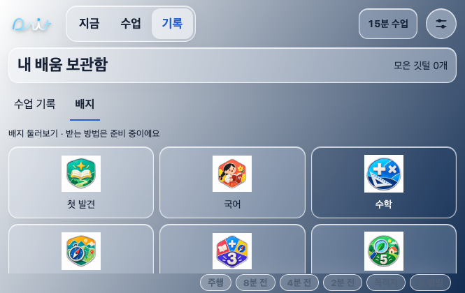

# Pearl 색상·유리 카드 후속 납품

2026-11-06. 통합 main `09f03e5`를 받은 뒤, 기존 Pearl 시안에서 요청된 색상 설정·유리 카드·로고 대비 처리를 **실제 WebView 앱**에 보완했다. 별도 공개 시안을 앱 최신본으로 덮어쓴 작업은 아니다.

## 변경

- 상단 설정 버튼에서 팝업을 연다. 앱 색상과 기존 학교·대화 설정으로 들어간다. 학교 검색·등록 기능은 유지한다.
- 시작 색·끝 색을 자유롭게 고르고 120도 배경 그라데이션으로 미리 본다. 진주색·블랙·화이트/네이비 조합도 제공한다. 저장하면 기기에 남고, 닫기·Escape·팝업 바깥 클릭은 저장 전 색상을 취소한다. 잘못된 코드와 저장 실패는 안내한다.
- 카드·메뉴·기록 블록에는 투명도와 배경 흐림을 적용한다. 글자에 흐림이나 투명도를 주지 않는다. 각 위치의 배경과 유리 층을 계산해 글자색을 정하고, 대비가 부족한 카드만 투명한 틴트를 보강한다.
- 원래 로고의 경로·색은 유지한다. 밝은 배경에는 검은 그림자, 어두운 배경에는 흰 글로우를 쓴다. 로고 하늘색과 거의 같은 배경일 때만 얇은 테두리를 표시한다. 진주색·흰색 배경에서는 테두리를 쓰지 않는다.
- 주행으로 바뀌면 설정을 닫고 미저장 색상을 되돌린다. 주행 중 설정 호출은 `주행중엔 설정을 바꿀 수 없어요.`를 표시한다.

## 보존한 범위

수업 5편과 음원 192개, 깃털·잇찌, 배지 둘러보기, 하교 대화, 기존 주행 화면과 주행 중 탐색 제한을 유지한다. 등교 대화·준비물·홈의 가 볼 만한 곳은 되살리지 않았다. 색상 팝업을 열거나 저장해도 수업 재생·일시정지 상태를 바꾸지 않는다.

## 검사

- 기존 앱 JavaScript 198개 + 중계 서버 9개 시험 통과.
- 수업 음원 192개 누락 검사 통과.
- Chrome 실제 화면: 665×420, 420×640에서 메뉴·색상 설정의 넘침과 44px 터치 높이 확인.
- 진주색·블랙·화이트/네이비의 홈·배지 6개 화면 확인. 배지·메뉴·제목의 계산 대비 4.5:1 이상 확인.
- 저장 후 재시작, 미저장 취소, 잘못된 색상 코드, 무관한 저장값 보존, 학교 설정 진입, 주행 전환 취소·접근 차단 확인.
- 실제 수업 음원 재생 중 색상 변경·저장 후 계속 재생, 일시정지 중 팝업을 열고 닫은 뒤 정지 유지, 주차 중 위치 이동·주행 중 이동 차단 확인.
- 브라우저 오류 0. Android 빌드·기기 설치·Gleo 실제 호출은 이번 작업에서 수행하지 않았다.

## 인계

이 납품의 완료 범위는 UI 보완 코드와 브라우저 확인이다. main 통합·최종 APK 확인은 앱 담당에게 전달한다. 기존 S13 완료를 다시 바꾸거나 C1·T7 담당자의 미납품 상태를 대신 완료 처리하지 않는다. 이전 공개 시안 링크는 그대로 유지한다.

재생 중 전체화면 구성·음량·이동 간격 설정 등 별도 시안과 실제 앱 사이의 나머지 차이는 이 변경에 포함하지 않았다. 이번 납품을 그 기능들의 앱 통합 완료로 기록하지 않는다.

