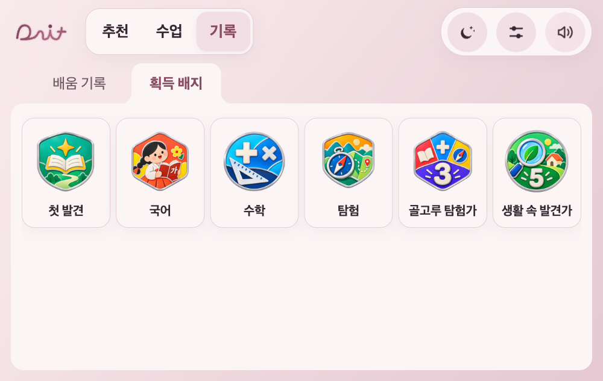
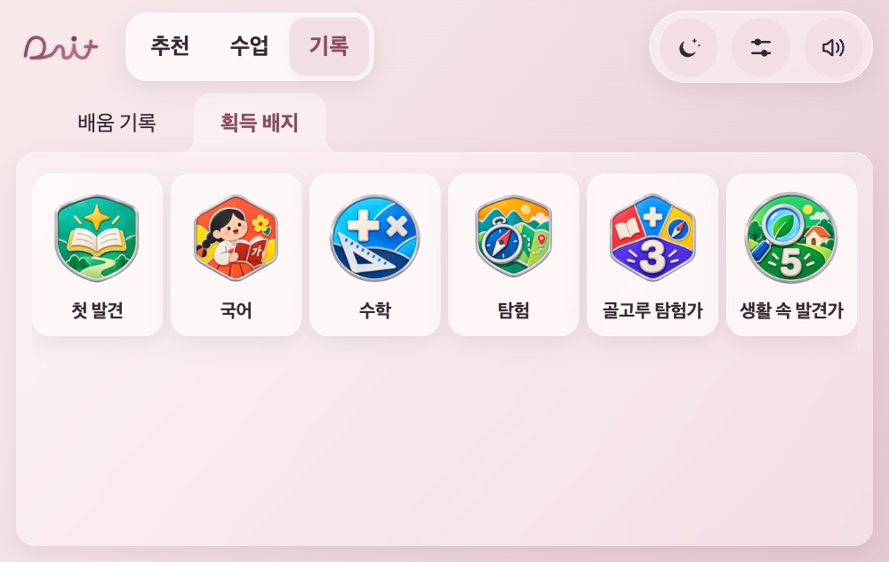
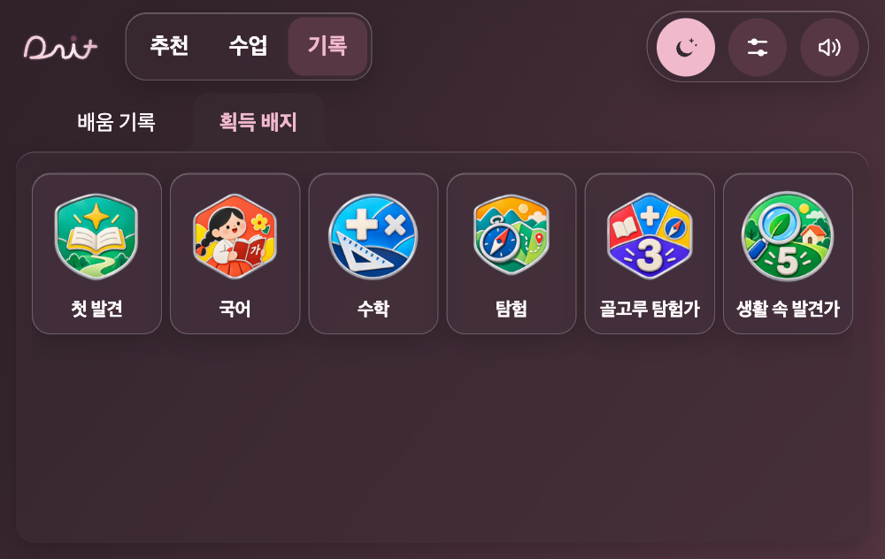

# Pearl 글래스 패널 마감

2026-11-09 · 이지민. 기준: `claude/pearl-screen-polish`의 `f4af9dc234a03a8ddbb97dc3ca4cec064a75ace7`.

원격 main은 `c8a555d`이며 최신 디자인은 아직 별도 브랜치다. 이 변경은 그 디자인 위의 후속이다. `codex/jimin-glass-finish`에서 작업했고, 원본 디자인 브랜치나 main에는 직접 쓰지 않는다.

## 바뀐 모습

불투명한 `--paper`를 유리 토큰으로도 쓰던 탓에 blur가 있어도 배경이 비치지 않았다. 메뉴·내용판·카드에 실제 알파 배경과 얇은 빛 반사·깊이감을 적용했다. 로즈 배색·레이아웃·문구·배지 그림과 이름은 유지했다.

- 큰 내용판/메뉴: 라이트 알파 .46, 다크 .56.
- 그 안의 배지·기록 카드: 라이트 .66, 다크 .68.
- 설정/음량 팝업: 라이트 .88, 다크 .90. 겹친 내용이 방해하지 않도록 덜 투명하게 했다.
- 텍스트·초/시간·재생 제목에 blur나 반투명 효과를 넣지 않았다. 수업 부제의 기존 opacity .75도 1로 바꿨다.
- blur를 지원하지 않는 환경은 모드에 맞는 불투명 바탕을 사용한다. 새 배경 애니메이션이나 글자 그림자는 추가하지 않았다.

## 가독성 보완

- 검은 배경을 라이트 모드에 고르면 전역 글자가 흰색으로 뒤집혀 밝은 설정 창에서 사라지던 경로를 수정했다. 패널의 기본 글자는 선택한 라이트/다크 재질에 맞추고, 밖에 놓인 재생 글자는 실제 위치의 배경에 맞춰 고른다.
- 수업 시간 탭·기록 탭과 재생 시간의 각 항목을 대비 보정에 포함했다. 시간 항목을 한 덩어리로 계산하지 않는다.
- 배경 대비 계산에 실제 135도 장밋빛 겹침을 포함했다. 기존 120도 사용자 배경만 계산할 때 생기던 오차를 줄였다.
- 강한 사용자 배경에서는 필요한 패널만 .86 바탕으로 보강하고, 노출된 글자는 필요할 때 검은색을 쓴다. 시간 글자 뒤에 새 블록을 그리지는 않는다.
- 사용자가 저장한 두 모드의 색과 저장 키/이관 로직을 이번 작업에서 변경하지 않았다. 로고의 경로·원색 토큰·인트로·보상 조건도 새로 정하지 않았다.

## 실제 확인

- Node 앱·relay 자동검사 **233개 통과**. 라이트 모드의 검은 사용자 배경에서도 설정 기본 글자가 밝은 패널에 맞게 유지되는 회귀 검사 포함.
- 실제 Chrome **1000×632, 665×420, 420×640**. 라이트/다크 기본, 라이트 검정, 라이트 흰색→파랑, 다크 흰색 조합(큰 두 크기에서 각5, 작은 크기에서 기본2)을 확인했다.
- 총 **12조합×6화면=72개**: 추천·수업 목록·배지·설정·재생 설정·재생. 실제 화면의 글자를 잠시 숨긴 별도 검사 캡처에서 배경 픽셀과 computed 글자색을 대조했다. 표본은 화면 안에 보이는 제목·부제·탭·시간·설정 텍스트이며, 대비 미달 **0건**, 측정 최저 **4.53:1**이었다. 임의의 모든 배경 조합을 보증한다는 뜻은 아니다.
- 검사 중 선택한 텍스트는 opacity1/filter none, 문서 가로넘침 없음. 수업 시작·멈춤·설정 이동과 주행 중 설정 제한도 확인했다. 배지 원본6장 디코딩 정상.
- Android APK 빌드·기기 성능·실차·배포는 수행하지 않았다. 재생/도착 규칙·획득 조건·새 콘텐츠는 수정 범위가 아니다.
- 로컬 확인: `http://127.0.0.1:8796/dait-preview.html?app=1&review=glass`.

## 같은 상태의 전후

1000×632 · 같은 URL·라이트 기본 배색·획득 배지 탭·같은6개 그림·스크롤0.

| 수정 전 | 수정 후 |
|---|---|
|  |  |

앱 담당은 이 변경을 최신 디자인 브랜치와 함께 통합한 뒤 APK를 빌드하면 된다. 코드 납품과 main 반영·빌드·배포는 구분한다.
