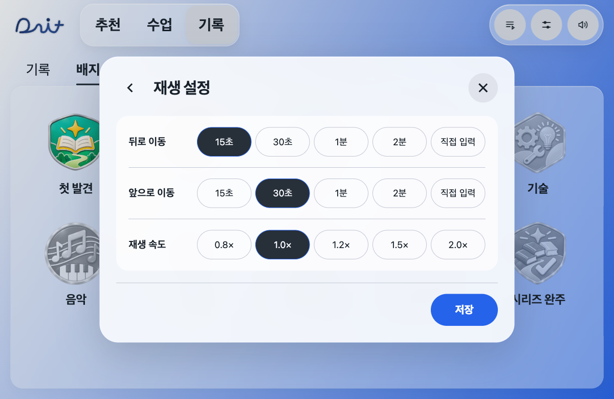
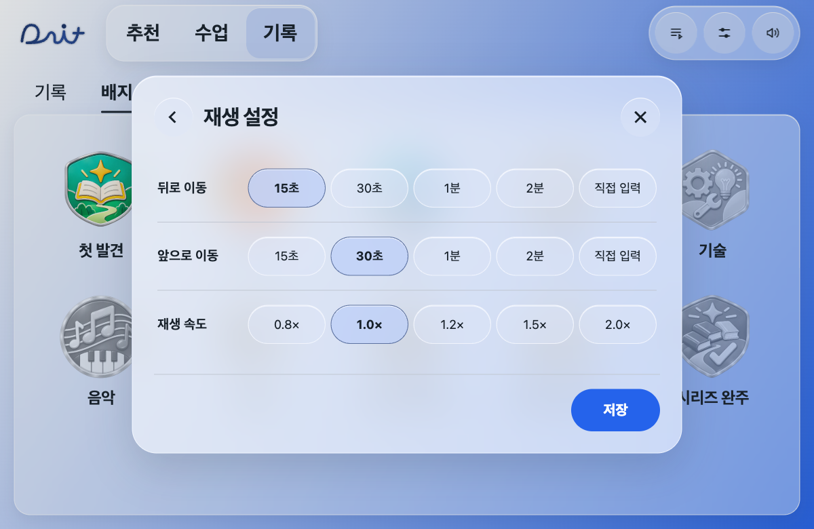
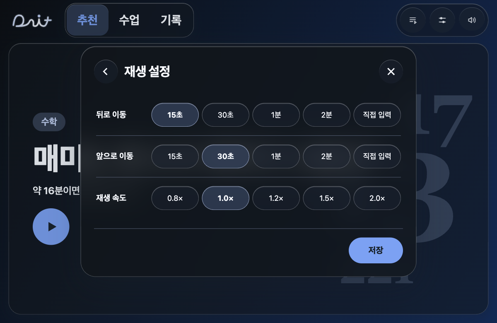
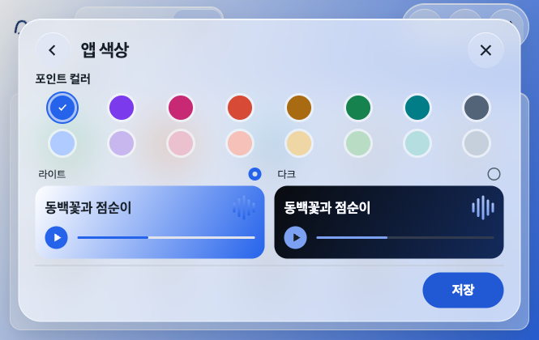

# 디자인 일관성 점검 — 2026-11-12

사용자 요청: 뒤로 버튼 원형 찌그러짐 수정 및 앱 전체 글래스모피즘 일관성 개선 제안.

## 적용한 수정

재생 설정의 뒤로 버튼은 36×44px, 닫기는 44×44px로 정의되어 있었다. 설정 헤더의 원형 버튼을 44×44px·축소 방지·1:1 비율로 통일했다. 포커스 테두리는 키보드 사용자를 위해 유지한다.

브라우저 계산값: 1200×780에서 뒤로/닫기 모두 57.53×57.53px(모달 확대 포함), 665/390/319 폭에서는 44×44px. 같은 재생 설정·색·포커스·1200×780 상태로 전후를 캡처했다. 기능 로직 변경 없음.

## 실제 확인한 불일치

- 상단 내비/도구/추천 카드 배경은 불투명도 .46, 설정창은 .94. 설정 안쪽 그룹은 다시 흰색 .68이어서 합성하면 약 .98로 거의 불투명하다.
- 재생 설정의 선택 칩은 원래 포인트 색을 쓰지만 자동 대비 처리(refreshInk)가 어두운 배경으로 덮는다. 가독성 기준과 재질 규칙이 분리되어 선택 색이 갑자기 검게 바뀐다.
- 상단은 18px 블러, 모달은 24px, 추천 카드는 중첩 렌더링 경계를 피하려고 블러 없이 반투명 재질만 사용한다. 역할별로 합의한 재질 단계가 아니라 예외 스타일이 쌓인 상태다.
- 반복 행, 배지, 목록 외곽과 내부 그룹의 선·그림자·불투명도가 겹친다. 하나의 유리면 안에 들어갈 항목이 별도 흰 블록처럼 보인다.

## 공통 재질 적용 — 사용자 후속 승인으로 반영

1. 카드·목록·떠 있는 창에 공통 유리 재질을 정의한다. 기본면/떠 있는 면/선택면의 세 단계만 두고 라이트·다크에서 같은 규칙을 쓴다.
2. 설정·재생목록·배지 상세를 하나의 유리 창으로 맞춘다. 안쪽 큰 흰 그룹은 투명하게 하고 여백·구분선으로 묶어 이중 불투명 쌓임을 없앤다.
3. 선택 칩은 선택한 포인트 색의 반투명 유리로 통일한다. 대비가 부족할 때 글자색을 먼저 보정하고, AA 대비를 이미 만족하는 버튼을 통째로 검게 덮지 않는다.
4. 원형 조작부는 같은 정방형·빛 방향·얕은 질감을 사용한다. 재생은 포인트 강조, 일반 조작은 얕은 유리로 역할을 구분한다. 키보드 포커스는 선택 표시와 분리한다.
5. 유리 효과는 큰 면에 한 번만 적용하고 안쪽 행·글자·시간·파형에 중첩 블러를 걸지 않는다. 기존 마우스 추종 경계 문제가 돌아오지 않게 한다.
6. 구분선과 그림자도 공통 단계로 맞춘다. 비활성은 재질 전체를 흐리기보다 아이콘/글자 톤으로 구분하고 대비를 점검한다.

2026-11-12 후속 요청으로 위 기준을 반영했다. 기본 면은 기존 반투명 재질을 유지하고, 떠 있는 창은 라이트 .64 / 다크 .74로 낮췄다. 내부 그룹은 투명하게 하고, 원형 조작부와 선택면에 공통 포인트 유리 토큰을 적용했다. 글자 대비를 먼저 보정하고 4.5:1을 이미 만족하는 면은 덮지 않는다. 재생 설정의 선택 글자는 같은 규칙으로 선택해 행별 색이 달라지지 않게 했다.

중첩 블러를 늘리지 않았고 추천 카드의 기존 렌더링 경계 방지 처리를 유지했다. 글자·시간·파형 자체에는 블러를 추가하지 않았다. 블러 미지원·투명도 줄이기 환경은 모든 재질을 공통 불투명 면으로 바꾼다.

### 검사

- Node 203/203 통과. 투명도 줄이기 및 블러 미지원 대체 재질 검사 포함.
- 실제 브라우저 16색×라이트/다크 재생 설정 32조합: 표시 글자 최소 대비 4.50:1 이상, 검은 덮개 0건. 이어서 선택 글자색 통일 후 다크 블루 최소 대비 10.75:1.
- 라이트/다크 헤더 원형 버튼은 1200×780 / 665×420 / 390×844 / 319×566에서 1:1. 다크에 남은 이전 52px 크기 우선순위도 제거했다.
- 설정·앱 색상·재생목록·이전 수업 안내·배지 상세·기록·재생·세로 볼륨을 확인했다. 차량 색상창 가로 넘침 없음.
- 재생 시간은 배경 투명, filter/backdrop-filter 모두 none. 기존 재생 위치·주행 정책 변경 없음.
- 브라우저 콘솔은 로컬 favicon.ico 404만 있음. 새 APK/에뮬레이터/실차 검사는 이번 범위에서 하지 않았다.
- 현재 세션의 Google Sheets 연결 도구가 없어 업무표에는 기록하지 못했다. 기존 행·수식은 건드리지 않았다. 아래 Git 결과와 검사 내용을 J4 메모에 추후 동기화해야 한다.

