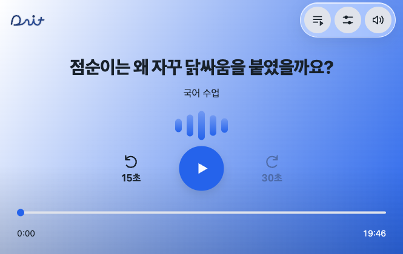
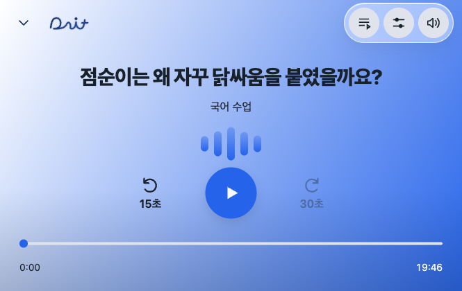
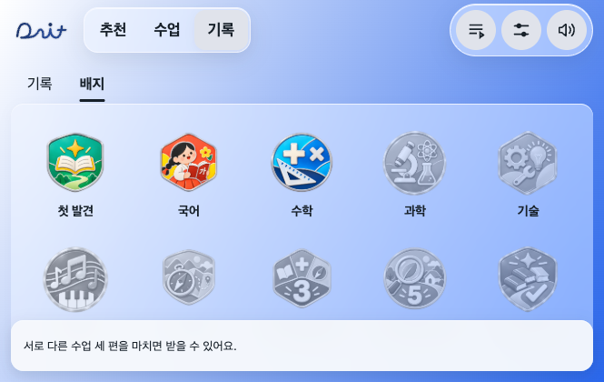
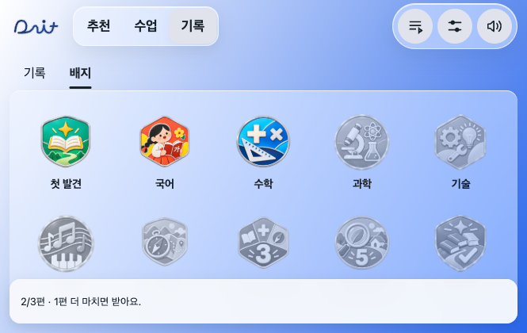
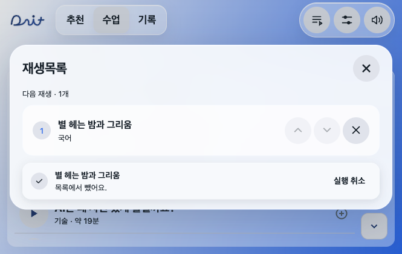

# 사용자 관점 사용성 개선 — 2026-11-12

2026-11-12 사용자 승인(문제 1~4 및 사용성 제안 전체)을 반영한다. 기준은 main 47ea07a. 공통 배색·기존 안내 간소화·기본 전체 재생 화면·들은 구간 안에서만 이동하는 정책은 유지한다.

## 적용 체크리스트

- [x] 마지막 수동 8·15·20분 선택을 탭 이동·재접속 뒤에도 유지한다. 내비 시간은 우선 적용하고 내비가 없으면 수동 선택으로 돌아온다.
- [x] 수업 기록에 분량과 실제 구성 조각을 저장해 복습한다. 이어 듣기로 마친 수업의 앞부분도 포함한다. 새 내비 시간이 있으면 도착 맞춤을 우선한다.
- [x] 첫 구간에서 중단한 정확한 초도 기록·공통 이어 듣기에 함께 저장한다. 구형 기록의 알려진 중단 지점도 연결한다.
- [x] 같은 추가 버튼의 700ms 내 연속 터치는 중복 추가하지 않는다. 충분한 간격을 둔 의도적 중복 추가는 유지한다.
- [x] 목록 삭제 후 실행 취소 토스트로 해당 고유 항목·순서를 복원한다. 다른 추가·이동을 덮어쓰지 않는다. 토스트는 열린 목록 모달 안에 표시한다.
- [x] 재생 화면 왼쪽 접기로 목록을 보며 듣는다. 오디오 순번·재생 위치·수동 일시정지를 유지하고 주행 중에는 접기를 막는다.
- [x] 기록은 제목·날짜·그래프·재생 표시를 포함한 행 전체가 하나의 터치/키보드 버튼이다.
- [x] 들은 범위를 넘는 이동의 첫 시도에만 짧게 안내한다. 위치 제한은 유지하며 버튼에 접근성 설명도 제공한다.
- [x] 미획득 배지를 누르면 현재 완료량과 남은 조건을 토스트로 보여 준다. 준비되지 않은 시리즈를 0/0으로 표시하지 않는다.

## 검증

- Node 202/202 통과. 시간 선택·초반 중단·복습 구성·접기/주행 차단·한 번 안내·삭제 복원·배지 진행량 회귀 시험 포함.
- 실제 브라우저: 20분 선택 → 추천 → 수업 → 새로고침 뒤 20분 유지, 약 1.35초 중단 위치 저장 및 이어 듣기, 20분 동백꽃 구성 1186.8초/조각 순서 동일 복습, 빠른 두 번 터치 1개 추가, 삭제/실행 취소, 기록 제목 터치로 재생 확인.
- 재생 중 접기 전후 오디오 순번과 상태 동일. 주행 상태에서 접기 숨김·동작 차단 확인.
- 665×420·390×844·1200×780에서 화면 넘침 없음, 접기/실행 취소 최소 터치 영역 44px 확인.
- 동일 URL·665×420·동백꽃 20분 일시정지 상태로 main 원본과 전후 캡처. 배지는 같은 완료 기록 2편으로 조건 토스트 비교.
- 새 APK 빌드·Android 에뮬레이터·실차 시험은 이번 범위에서 하지 않았다.

## 기존 기록 처리

새 기록은 구성 조각과 시간을 정확히 보존한다. 구형 기록은 저장된 전체 길이로 8/15/20분 분량을 추정하고, 그 정보도 없으면 기존 짧은 판/기본값을 쓴다. 저장되지 않은 과거 조각 순서를 만들어 내지 않는다. 유효한 기록·배지 원장은 삭제하지 않는다.

## 화면

폭 360px 이하의 아주 좁은 데스크톱 미리보기 창에서는 메뉴를 두 줄로 배치해 상단 음량 버튼 잘림을 막는다. 차량 기준 폭은 한 줄을 유지한다.
