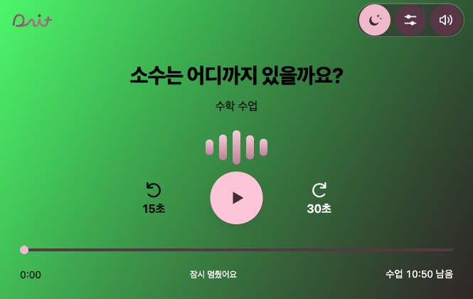
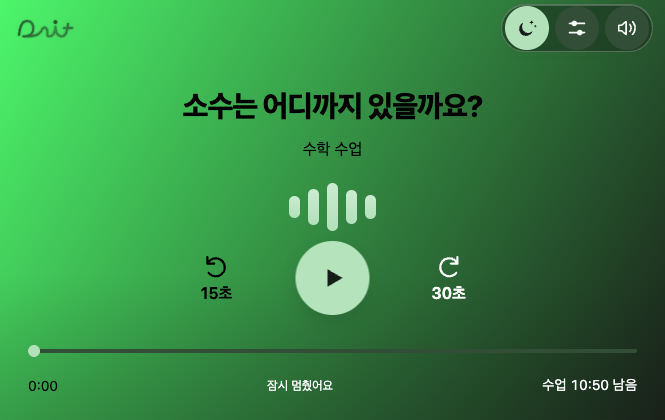
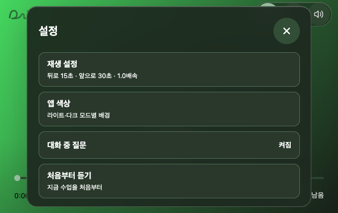
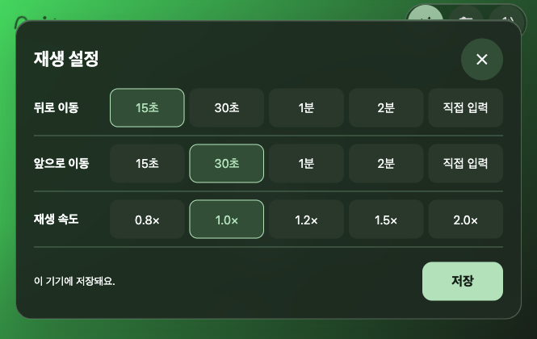
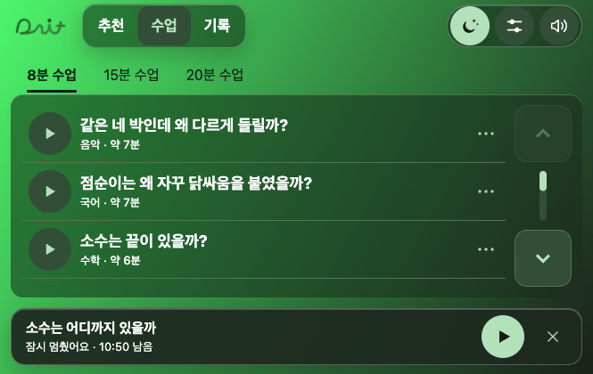
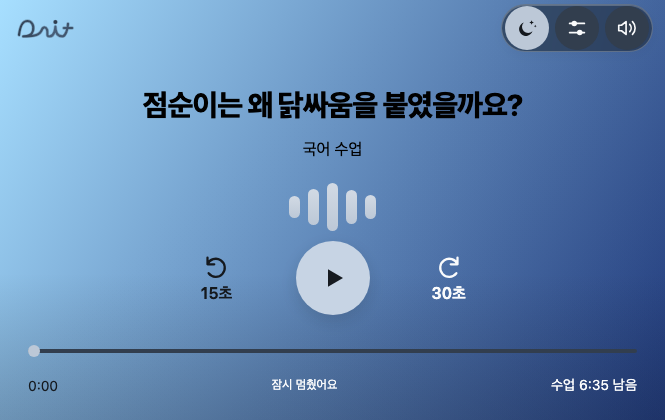
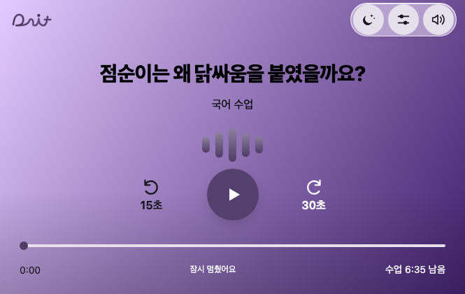
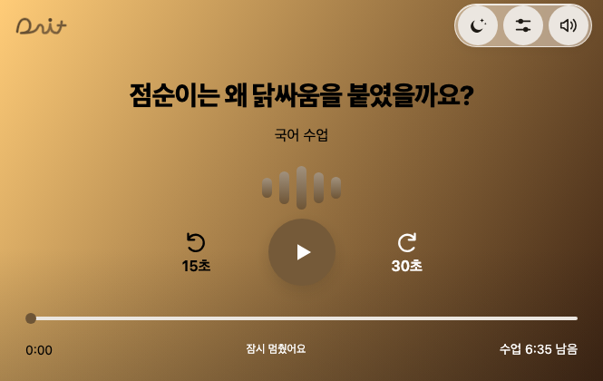

# 사용자 배색 자동 연결

2026-11-09 · 이지민. `codex/jimin-player-ux`의 3c62951 후속. 사용자가 고른 두 배경색에 로고·설정·재생·미니 플레이어의 색도 어울리도록 연결한다.

- `dait-palette.js`의 순수 배색 계산이 두 색의 채도를 반영한 대표 색상을 정하고 강조색·글자·유리 재질·테두리·그림자·파형·초점/선택 색을 함께 만든다. 무채색은 무채색으로, 기본 로즈의 강조색은 기존 색으로 유지한다. 배경의 시작/끝 색과 라이트·다크 저장 자료는 바꾸지 않는다.
- 메뉴 버튼, 음량 슬라이더, 설정/재생/앱 색상 상세 팝업, 주요 재생 버튼, 시간 막대, 하단 미니 플레이어가 같은 토큰을 쓴다. 극단적인 노랑·라임에서도 버튼 글자 대비를 확보하도록 강조색 명도를 보정한다.
- 로고의 필기체 모양은 유지하고 색상만 배경 계열로 맞춘다. 로고 위치의 밝기를 읽어 어두운 잉크/밝은 잉크를 선택한다. 내부 경로에는 필터를 걸지 않고 바깥 마스크만 그림자/글로우를 받는다. 테두리는 배경 대비가 부족할 때만 표시한다. 인트로 로고 색도 같은 팔레트를 쓴다.
- 색상판을 움직일 때 전체 배색을 즉시 미리 보고, 취소하면 전체가 복구된다. 저장 후 새로 열거나 모드를 왕복해도 각각 저장한 배경에서 배색을 다시 계산한다. 파생 색상은 저장소에 중복 저장하지 않는다.
- 글자/시간에는 유리판이나 흐림 효과를 붙이지 않는다. 밝고 어두운 색이 섞인 배경에서는 재생 화면 하단 전체에 옅은 음영을 더해 시간 문구를 읽기 쉽게 한다. 블러를 지원하지 않는 브라우저에서는 같은 계열의 불투명 재질로 대체한다.
- 수업/음원 내용, 시간 이동/내비 맞춤, 재생 세션·미니 플레이어 동작과 주행 중 설정 차단은 기존 경로를 유지한다.

## 확인

- Node 앱/relay **241개 통과**. 새 검사에는 모드 왕복 시 파생 토큰 복원, 서로 다른 색 계열/무채색의 재질·로고, 노랑·라임을 포함한 RGB 격자 **432배색**의 버튼/본문 대비가 포함된다.
- Chrome **1000×632·665×420·420×640**, 기본 로즈/초록/파랑/보라/주황/극단 배경을 포함한 **25개 크기·배색 조합 × 9화면 = 225화면**. 화면에 실제 표시되는 글자의 픽셀 배경 대비에서 일반 글자 4.5:1, 큰 글자 3:1 미달 0. 글자 opacity1/filter없음·가로 넘침 없음·주행 중 설정 차단 유지. 숨겨진 스크린리더 전용 색상 레이블은 화면 대비 표본에서 제외한다. `자동배색-검증-2026-11-09.json`.
- 실제 색상판 드래그/색조 변경으로 로고·강조색·패널 동시 미리보기, 저장 전 닫기 복구/조기 저장 없음, 저장 후 새로고침·라이트/다크 왕복 복원 확인. 공유 브라우저의 사용자 저장 자료는 덮어쓰지 않고 분리된 시험 컨텍스트에서 확인했다.
- Android APK 빌드·실기기·실차·최종 배포는 이번에 하지 않았다. 코드 납품과 앱 담당의 병합/빌드/배포를 구분한다.

## 같은 URL·상태·665×420 전후

사용자가 보낸 초록 계열 문제를 재현한 두 색 `#4df66b` → `#191d18`, 다크 프로필, 수학 첫 조각 0:00·일시정지. 원본 첨부의 정확한 색상 코드를 추정 확정한 것은 아니다.

| 전 | 후 |
|---|---|
|  |  |

| 파랑·다크 | 보라·라이트 | 주황·라이트 |
|---|---|---|
|  |  |  |

확인: http://127.0.0.1:8796/dait-preview.html?app=1&review=glass . PR14가 3c62951까지만 디자인 브랜치에 병합되어 자동 배색은 별도 PR15(https://github.com/cordmin/HYUNDAI/pull/15)로 납품한다. 기준 디자인 브랜치 3b67f32는 3c62951과 코드 트리가 같음을 확인했다.
