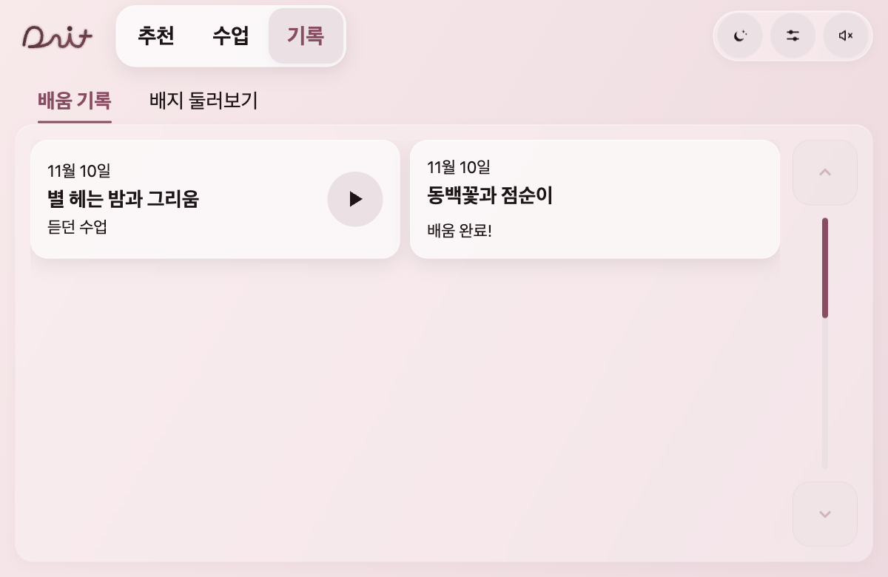
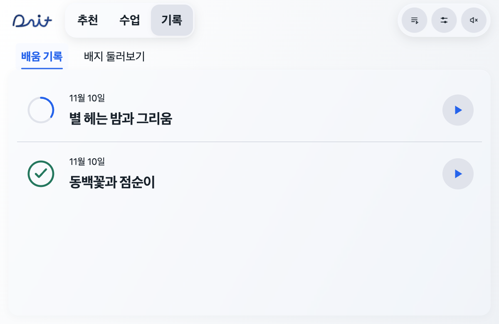
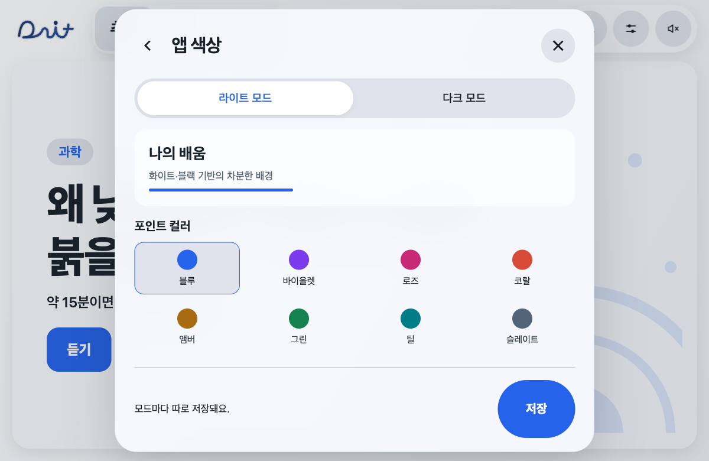
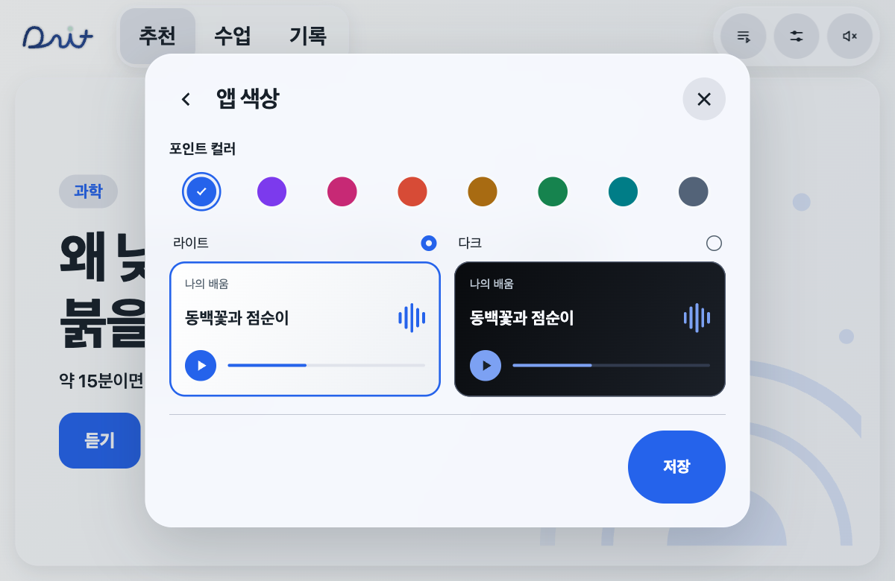
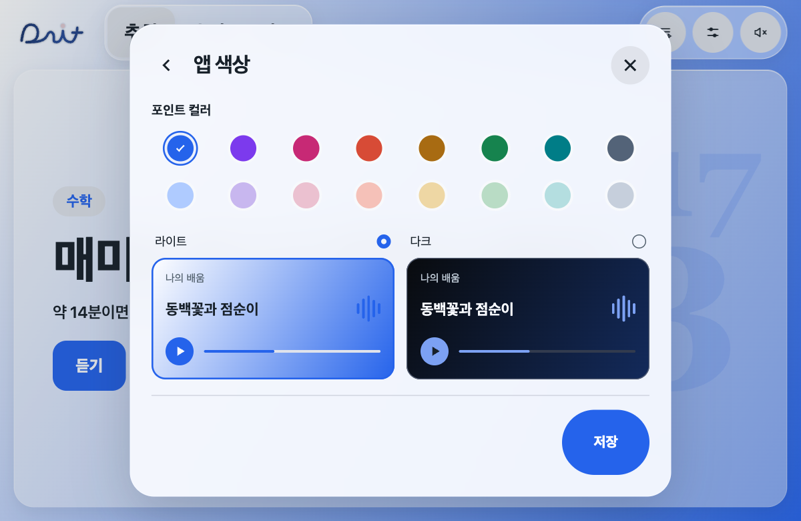
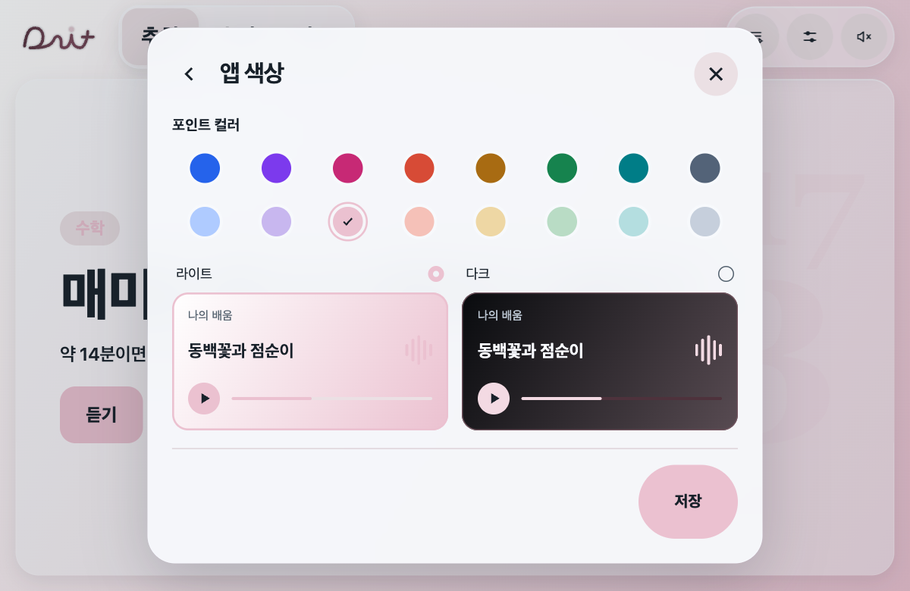
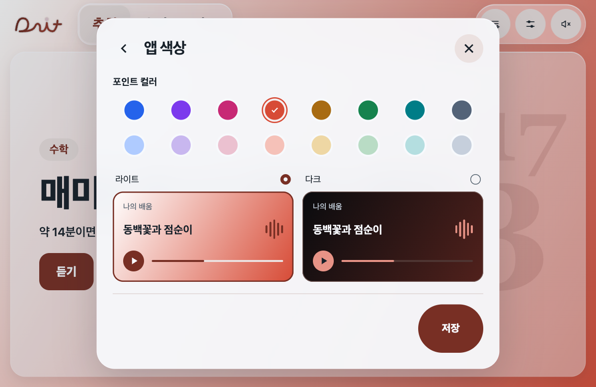
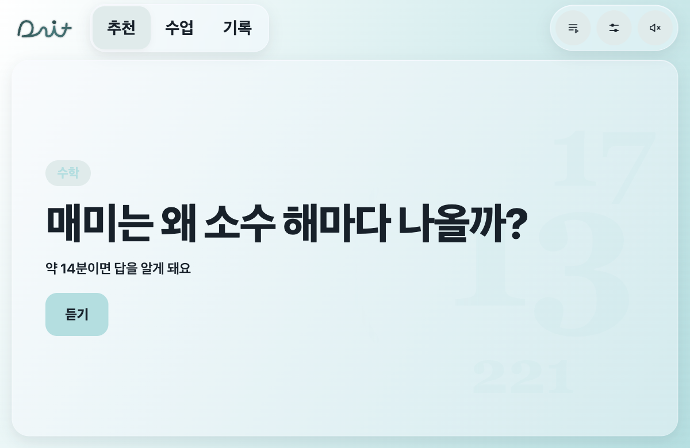
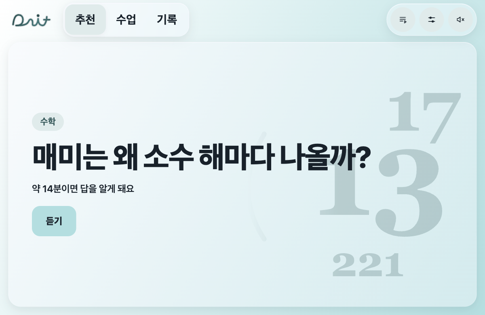
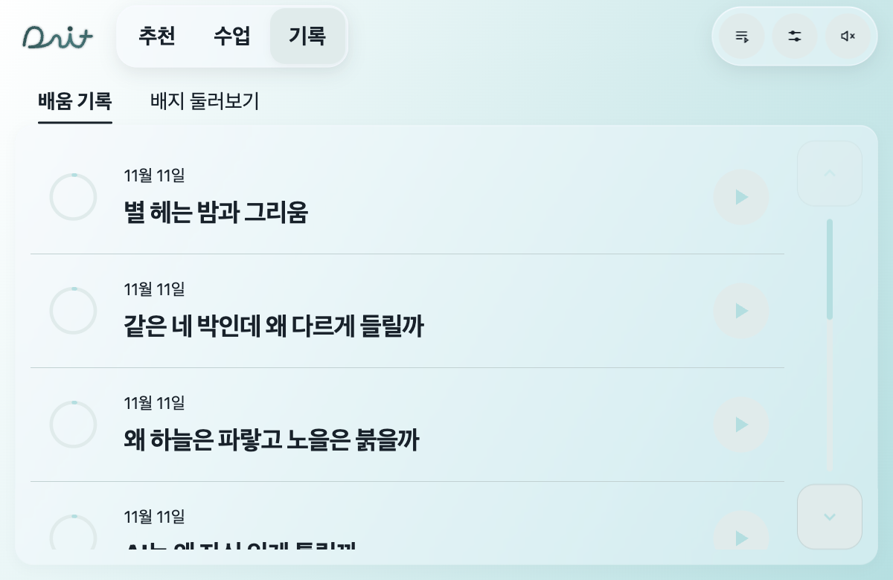

# 배지·재생·설정 수정

사용자 요청 체크리스트. 앞으로 이동은 미청취 구간으로 건너뛰지 않고 들은 구간 안에서만 이동하도록 유지한다.

- [x] 실제 완료 기록을 별도 배지 원장에 누적하고, 미획득 흑백·획득 컬러 표시
- [x] 획득 배지: 좌측 확대 그림 / 우측 의미·획득 배경·날짜 모달
- [x] 미획득 배지: 터치 시 조건 토스트
- [x] 일시정지 안내 문구 제거, 플레이·일시정지 아이콘으로 상태 표시
- [x] 남은 시간은 숫자만 표시
- [x] 라이트 화이트 / 다크 블랙 기반 그라데이션과 공통 16가지 포인트 색
- [x] 재생목록 진입은 목록에 남기고 설정의 재생목록 항목 제거
- [x] 상단 라이트·다크 터치 버튼 제거
- [x] 마우스 이동 때 보이는 카드 불투명 선 제거
- [x] 들은 구간 안의 앞으로 이동과 경계·일시정지 상태 검증
- [x] 추천 카드 분량과 실제 시작 분량 일치
- [x] 같은 상태·크기의 화면 비교, 기능 시험
- [x] 상단 재생목록·설정·음량 순서와 바깥 테두리 간격
- [x] 기록 A안: 완료 체크 링 / 듣던 수업 진행 링 + 양쪽 모두 재생 버튼
- [x] 기록 상태 문구·남은 시간 숫자 제거
- Git 납품 링크와 공유 업무표 기록은 PR 및 업무표 J4에 남긴다.

## 결과 및 검증 (2026-11-11)

- Node 기능 시험 190/190 통과. 실제 브라우저 음원 재생·일시정지·뒤로/앞으로·완료 복습·기록 이어 듣기를 확인했다. 앞으로 이동은 사용자 답변대로 들은 범위 안에서만 허용한다.
- 추천 카드에서 짧은 수업을 누를 때 기존 15분 세션이 재사용되던 문제를 수정했다.
- 마우스 위치만 달리한 화면은 애니메이션을 잠시 정지한 조건에서 동일한 픽셀이다. 카드의 중첩 backdrop-filter를 제거해 움직이는 불투명 경계를 없앴다.
- 화면 확인: 1200×780, 차량 기준 665×420, 좁은 창 390×844. 획득 배지 상세는 665×420에서 설명·날짜까지 보인다.
- 이전 임의 배경 색상 데이터는 삭제하지 않고 v5 중립 배경/공통 포인트 설정으로 전환한다. 기존 v4에서는 현재 사용 중인 모드의 포인트 색을 가져와 양쪽 모드에 사용한다. 저장하지 않고 닫으면 이전 설정을 복구한다.
- 실제 차·새 APK·Android 에뮬레이터 검사는 이번 범위에서 하지 않았다.

## 배지 조건

첫 발견(첫 완료), 국어·수학·과학·기술·음악(해당 과목 첫 완료), 탐험(서로 다른 수업 3편), 골고루 탐험가(3과목), 생활 속 발견가(완료한 날 총 5일, 연속 불필요), 시리즈 완주(제작자 자료의 필수 편 전체 완료). 시리즈는 2편 이상이고 모든 필수 조각의 음원이 있어야 획득한다. 사용자가 시리즈를 만들지 않는다.

원장은 최근 수업 목록이 줄어도 획득 내역을 유지한다. 기존 완료 기록의 알려진 날짜를 사용하며 날짜가 없으면 날짜 정보 없음으로 표시한다. 장기 배지 확장안 전체를 구현한 것으로 표시하지 않는다.

## 선택된 기록 화면

3세트 중 A안을 사용자 선택으로 반영했다. 아래의 배움완료·듣던수업 문구와 남은 시간 숫자는 최종 요청에 따라 제거했다. 원형 그래프, 날짜, 콘텐츠 제목, 재생 버튼만 남긴다.

## 후속 수정: 공통 색과 두 모드 예시

- 사용자 최신 요청에 따라 모드별 개별 색 저장을 폐기했다. 색상 원 8개에 이름을 표시하지 않고, 선택한 한 색의 라이트·다크 적용 예시를 동시에 보여 준다. 미리보기를 누르면 화면 밝기를 선택한다.
- 색상 클릭의 조상 탐색이 앱 영역의 data-color-mode까지 올라가던 오류를 버튼 범위로 수정했다. 원·체크 SVG·버튼 여백 클릭 및 키보드 Space가 같은 선택으로 처리된다.
- 대비 검사에서 aria-hidden 장식을 제외하고, 독립된 두 미리보기는 각 모드의 검증된 토큰으로 표시한다. 두 시리즈 스위치는 같은 둥근 목록으로 묶었다.
- Node 191/191 통과. 브라우저에서 8색 모두 선택, 공통 색 저장/재접속, 미저장 닫기 복구, 키보드 선택, 라이트/다크 설정의 검은 덮개 없음 확인. 665×420에서 스크롤 없이 저장 버튼까지 보인다.

## 16색과 배경 그라데이션 (사용자 추가 요청)

기존색 8개 아래에 같은 계열의 파스텔 8개를 각각 배치한다. 좁은 창에서도 색상 쌍을 유지한다. 라이트 배경은 화이트에서 선택한 색으로, 다크는 블랙에서 같은 색의 어두운 톤으로 연결한다. 단일 포인트 값으로 배경·버튼·로고·미리보기를 함께 계산하며, 색 이름은 화면에 표시하지 않는다.

Node 192/192 통과. 16색 실제 클릭과 그라데이션 끝 색 일치, 파스텔 저장·재접속, 두 모드 예시, 665×420/390×844에서 스크롤 없이 표시 확인.

## 미리보기와 실제 재생 화면 일치

라이트·다크 미리보기의 일반/선택 테두리와 내부 선 그림자를 제거했다. 모드 선택은 위쪽 원형 표시로만 구분한다. 미리보기 파형과 실제 `.dait-sound`는 같은 그라데이션 선언을 공유한다. 브라우저에서 두 모드 모두 border 0px/box-shadow none, 파형 linear-gradient 적용과 색 선택 유지 확인. 기능 로직 변경 없음.

## 파스텔 과목명과 주제 무늬 대비

과목명에 채움색을 그대로 쓰지 않고 같은 색상 계열의 별도 글자색을 사용한다. 16색×라이트/다크에서 과목명/알약 배경 대비 4.5:1 이상 확인. 숫자·과목 주제 무늬도 별도 색과 불투명도(라이트 .24/다크 .22)로 분리해 파스텔에서 사라지지 않게 한다. 본문 쪽 마스크는 유지한다. Node 192/192 통과, 동일한 매미 카드·파스텔 틸·1200×780 전후 및 665×420 확인.

## 기록 조작부 대비와 화살표 크기

진행 링·재생 아이콘·스크롤 화살표/손잡이에 파스텔 채움과 분리한 같은 계열의 진한 조작색을 사용한다. 16색×두 모드에서 조작색/채움 대비 4.5:1 이상, 진행 링 값/바탕 대비 3:1 이상 확인. 완료 체크 링 색은 유지한다.

기록·수업 목록의 공통 스크롤 버튼을 52u에서 36u로 줄이고 최소 44px은 유지한다(1200 창 88→61px, 차량 기준 665 창 64→44px). 화살표 그림도 함께 줄였다. 실제 기록 스크롤 0→419.5px 이동, 라이트/다크 및 665×420 확인. Node 192/192 통과. 기존 이동 시험의 실제 시계에 따른 1ms 흔들림은 해당 시험의 시계를 고정해 제거했다(앱 이동 로직 변경 없음).

