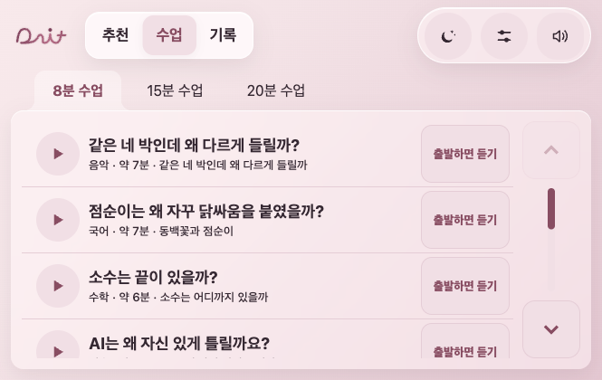
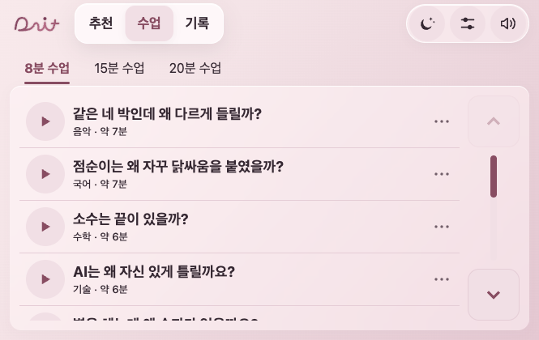
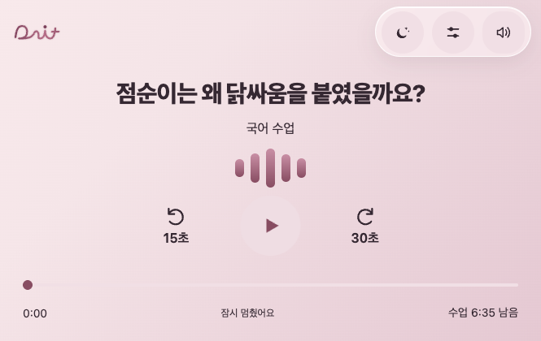
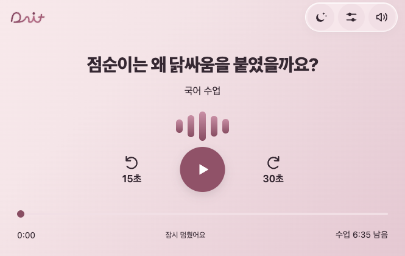
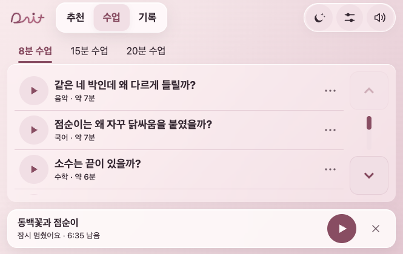
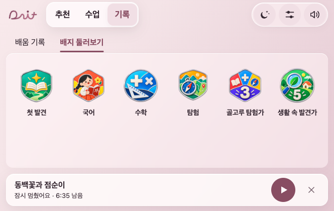

# 재생 탐색·미니 플레이어·화면 정리

2026-11-09 · 이지민. 기준 `claude/pearl-screen-polish`의 `72ceddf6a9f508e46bec73b5d29c1b9af55e9893`(글래스 PR13 병합 후). 작업 브랜치 `codex/jimin-player-ux`.

## 고친 경험

- 수업을 들으며 로고·추천·수업·기록으로 이동해도 소리가 이어진다. 미니 플레이어에서 멈춤/이어 듣기, 같은 재생 화면 복귀, 명시적 수업 종료를 할 수 있다.
- `currentMode='lesson'`은 재생 세션의 소유자로 유지하고, `lessonView`만 탐색 화면을 바꾼다. 화면 전환 때문에 오디오를 다시 틀거나 순번·구간·초·수동 멈춤을 초기화하지 않는다. 차 미디어·Gleo·ETA·발문 대기 흐름은 기존 재생 경로를 사용한다.
- 지금 듣는 수업을 목록에서 다시 누르면 재시작 없이 재생 화면으로 돌아간다. 다른 수업을 시작하면 기존 구간/초를 먼저 저장한다. 미니 플레이어 X는 수업을 끝내고 위치를 저장한다. 전체화면에서 시스템 뒤로 가기는 추천으로 이동하고, 추천 루트의 뒤로 가기는 시스템에 넘긴다.
- 탐색 중 주행으로 전환하면 같은 세션의 전체 재생 화면으로 돌아가고 미니 플레이어/탐색 조작을 숨긴다. 출발 예약이 있으면 기존 예약 규칙으로 고른 수업을 시작한다. 설정/옵션·자유 탐색 제한, 시간 기준 앞뒤 이동과 내비 시간 맞춤은 유지한다.
- 기존 동작대로 도착 처리·수업 종료는 세션을 마무리한다. 시스템의 앱 종료 이후 백그라운드 재생이나 실제 차량 검증을 완료했다는 의미는 아니다.

## 화면 변화

- 상단 도구 터치 영역44px 이상을 유지하며 높이 축소. 연결형 브라우저 탭 모양을 텍스트+선택선으로 정리했다.
- 각 수업의 반복 예약 버튼을44px 옵션 버튼으로 이동. 옵션 팝업에서 기존 `출발하면 듣기`/`예약 취소`를 사용한다. 예약된 행에는 출발 대기를 표시하고, 예약 만료도 탐색 중 화면에 반영한다.
- 제목은 질문 한 번, 부제는 과목·실제 길이만 보여준다. 큰64px 목록 이동 버튼은 유지한다.
- 665×420에서 목록 시작 y122→106, 온전히 보이는 기본 행3개→4개. 재생 중에는 미니 플레이어가 아래 공간을 사용한다.
- 주재생 버튼은 진한 로즈 바탕과 선명한 아이콘으로 강조했다. 일시정지·중단에는 파형 빛이 움직이지 않고, 주행/동작 줄이기 모드에서도 정지한다.
- 겹친 카드 그림자를 줄였다. 기존 배지6개 그림은 보존하고 안쪽 카드의 겹친 윤곽·광택을 덜었다. 탭 이름을 `배지 둘러보기`로 바꿨으며 지급/획득 조건을 임의로 확정하지 않았다.
- 기존 로즈·글래스 재질·다잇 로고·색상 저장·대본·음원224개는 유지한다.

## 확인

- Node 앱/relay **238개 통과**. 새 회귀 검사5개는 탐색 중 같은 세션/순번, 수동 멈춤·핸들 시간 이동·주행 복귀, 다른 수업 교체 전 위치 저장, 뒤로 가기, 예약 만료를 검사한다. 기존 기록 테스트는 화면 탐색과 명시적 종료를 구분하도록 바꿨다.
- 실제 Chrome1000×632·665×420·420×640에서 재생→탐색→멈춤→복귀, 탐색 중 다음 음원, 미디어 시간 이동, 옵션 닫기/예약/취소, 출발 예약 소비, 주행 중 옵션 차단, 명시적 종료 확인. 다음 음원 전환은 검사용16배속으로 실제 음원 종료 이벤트를 발생시켰다. 기술 동작 확인이며 품질 청취가 아니다.
- 12개 크기/배색 조합×7화면 **84개** 표본의 배경 픽셀 대비 미달0, 최저4.53:1. 기본 라이트/다크와 강한 사용자 배경 포함. `UX-배색-검사-2026-11-09.json`, `UX-재생-흐름-검사-2026-11-09.json`.
- 일시정지 화면에서 빛 애니메이션0개, 665×420 목록에서 높이44px 미만의 표시 버튼0개. 배지 그림6개 정상 디코딩.
- Android APK 빌드·실기기·실차·최종 배포는 미실시. 브라우저의 주행/미디어 입력은 시험용 입력이며 하드웨어 검증으로 쓰지 않는다.

## 전후: 같은 URL·기본 배색·665×420

목록은 진도 없는 상태·8분·스크롤0, 재생은 동백꽃 첫 조각·0:00·일시정지다.

| 전 | 후 |
|---|---|
|  |  |
|  |  |

확인 주소: http://127.0.0.1:8796/dait-preview.html?app=1&review=glass . 앱 담당은 최신 디자인 브랜치에 이 후속을 합쳐 함께 빌드하면 된다. main 직접 반영·배포 완료와는 구분한다.
