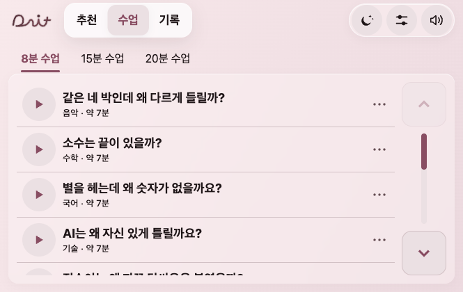
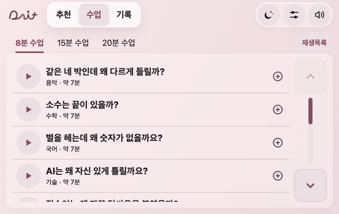
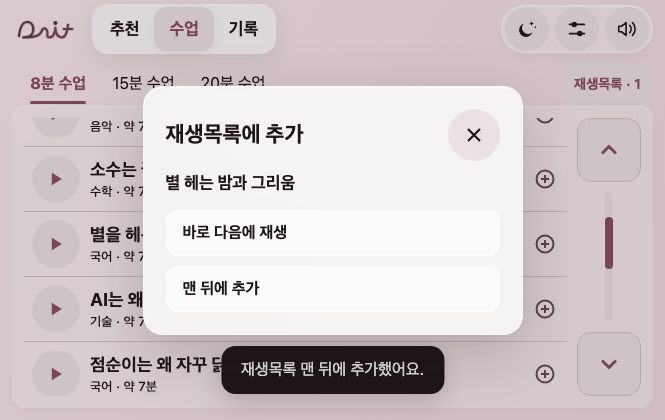
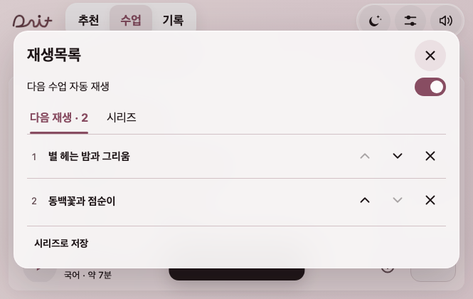
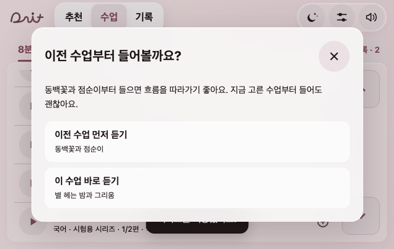

# 출발 예약 제거·재생목록과 시리즈

2026-11-09 · 이지민. 기준 main 37f19b7(팀원 배속 유지 수정 포함), 작업 브랜치 codex/series-playlist.

사용자 결정: 출발 시 듣기 예약은 필요 없다. 시리즈 순서·선택 가능한 자동 재생·재생목록 추가를 준비한다. **시리즈 구성은 나중에 정하고 기능만 준비한다**는 답을 반영해 공식 시리즈 자료는 빈 배열로 둔다. 기존 여섯 수업 사이의 선수 관계를 임의로 지정하지 않는다.

## 기성 사례와 선택

- [Apple Podcasts 재생 대기](https://support.apple.com/guide/podcasts/choose-which-episodes-play-next-pod64adbf9aa/1.1.0/mac/27): Play Next는 맨 앞, Add to Queue는 맨 뒤에 넣고 목록을 편집한다.
- [Pocket Casts Up Next](https://support.pocketcasts.com/knowledge-base/up-next-continuous-playback/): 직접 담은 목록과 자동 재생을 구분하고 Play Next/Play Last 및 삭제를 제공한다.
- [Apple Podcasts 회차 순서](https://support.apple.com/en-kw/guide/iphone/iph4003ecb12/ios): 프로그램의 회차 순서에 따라 남은 회차를 재생한다.
- 다잇은 두 동작이 있으므로 + 버튼을 누른 뒤 **바로 다음에 재생 / 맨 뒤에 추가**를 고른다. 재생목록은 현재 수업과 다음 목록을 구분한다. 직접 고른 목록이 시리즈의 자동 다음 편보다 우선한다. 위/아래 버튼과 삭제를 제공하며 44px 이상 터치를 유지한다.

## 구현

- 출발 예약 상태·30분 타이머·주행 시작 자동 실행·예약 점 깜빡임·예약 메뉴를 제거했다. 목록에 수업을 담아도 출발만으로 재생하지 않는다.
- `dait-playlist.js`는 DOM 없는 목록/시리즈 모델이다. `dait-app-playlist.js`가 수업·내비·기기 저장과 연결하고, `dait-queue-ui.js`가 기존 유리 설정창으로 편집한다. 기존 시간 이동·라이트/다크별 배색·핸들 조작·음량·이어 듣기·기록을 유지한다.
- 다음 수업 자동 재생(기본 켜짐)을 끄면 현재 수업 뒤에 멈추며 목록은 보존한다. 자연 종료에서만 다음을 시작하고 사용자 종료·일시정지·통화 등 시스템 중단·도착 처리에서는 목록을 소비하지 않는다. 남은 시간에 첫 항목이 안 들어가면 다음 이동을 위해 남긴다. 빈 목록/시리즈가 아닌 일반 긴 이동은 기존 추천 교시/휴식을 유지한다.
- 자동 전환이나 수업 선택은 목록의 사용한 항목만 소비한다. 중복 수업을 명시적으로 넣을 수 있고 이미 소비한 항목을 다시 계획하지 않는다. 듣던 수업의 +에서 넣은 이어 듣기 의도는 저장하며, 유효한 재개 지점이 있으면 잇는다. 재시작·모드 변경 후 목록과 설정을 복원하지만 사용자 동작 없이 소리를 시작하지 않는다.
- 이전 편이 미완주이면 주차 중에 먼저 듣기/이 수업 바로 듣기를 제시한다. 강제하지 않으며 주행 중에는 선택 모달을 띄우지 않는다. 이미 듣는 같은 수업으로 복귀할 때는 다시 묻지 않는다.
- 재생목록을 내 시리즈로 저장할 수 있다. 공식 자료와 내 시리즈를 구분해 공식 자료를 사용자 저장소에 복제하지 않는다. 팀의 공식 구성은 `dait-series.js`에 나중에 넣는다.
- 시리즈 순서대로 듣기와 시리즈 연결 안내는 각각 켜고 끈다. 앞편을 실제 마쳤고 시간 예산이 허용되는 원래 판에서만 기존 복습 음원을 연결한다(짧은 판의 기존 복습 생략 규칙 유지). 상관없는 수업을 지난 시간이라고 붙이지 않는다. 별도의 시리즈 예고 대본·음원은 아직 만들지 않았다.
- 향후 공식 시리즈의 `outros`에 수업 ID별 `{clip:'lesson/음원ID',seconds:실제길이,text:'화면문구'}`를 넣으면 같은 시리즈의 다음 편을 이어 들을 때 정리 뒤에 붙는다. 현재 다음 편·설정·도착 상태와 맞지 않으면 건너뛴다. 제출 전 검사 도구는 잘못된 순서/없는 예고 음원 참조를 차단한다. 실제 시리즈 구성/예고 음원 납품과 기능 준비를 구분한다.

## 검증

- Node **165개 통과**. 출발 예약 폐기에 맞춰 해당 시험 9개를 제거하고 목록 순서·중복·저장/손상·직접 목록 우선·자동 재생 끄기·자연 종료/명시 종료·일시정지/중단·도착/짧은 ETA·선수 안내·실제 앞편 복습·예고 연결 자리·없는 예고 음원 차단을 시험했다. 기존 긴 이동·핸들·내비·배속 검사도 통과했다.
- 현재 JS18개 문법 검사, 여섯 수업의 **282개 음원 파일 누락0**, 공식 시리즈0(의도한 상태).
- Chrome **665×420·1000×632·420×640**, 라이트/다크와 초록 사용자 배경 포함7조합×7화면=**49화면**. 실제 표시 글자 픽셀 대비 미달0·가로 넘침 없음. 추가/다음/순서 이동/삭제/내 시리즈 저장/순서 경고와 건너뛰기/설정/다시 열기/주행 차단 확인.
- 재생 중 목록을 열어 둔 채 실제 마지막 음원 종료→다음 수업→목록 소비·지금 수업 표시 갱신을 확인했다. 검사용 이미 들은 구간 설정과 마지막 음원16배속을 사용한 기술 검사이며 품질 청취가 아니다. 팀원 배속 수정37f19b7을 받은 뒤 같은 경계를 최종 재검사했다.
- Android APK 빌드·실기기·실차·배포는 이번에 하지 않았다.

## 동일 URL·상태·665×420 전후

URL은 `http://127.0.0.1:8796/dait-preview.html?app=1&rev=main-99e47fe`, 기본 라이트·8분·빈 진도/목록·스크롤0이다. URL의 이전 커밋 표시는 캡처 조건이고 실제 소스는 현재 작업 브랜치다.

| 전 | 후 |
|---|---|
|  |  |

시리즈 관련 그림은 분리된 브라우저의 **시험용 시리즈**다. 실제 배포 자료에 포함한 시리즈가 아니다.
