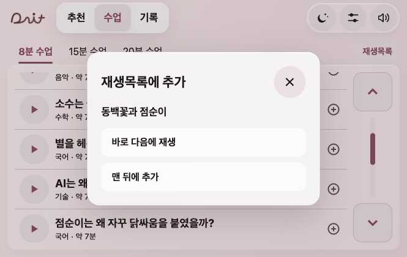
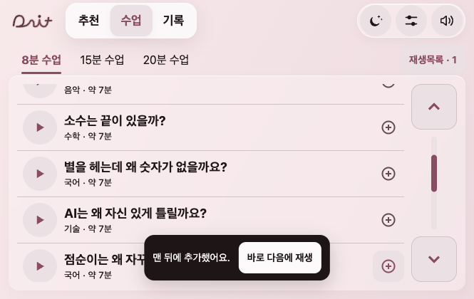
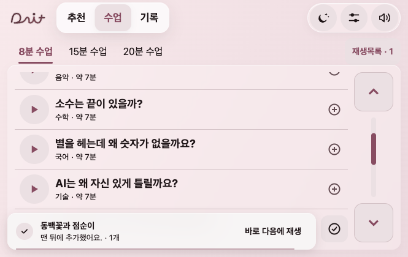
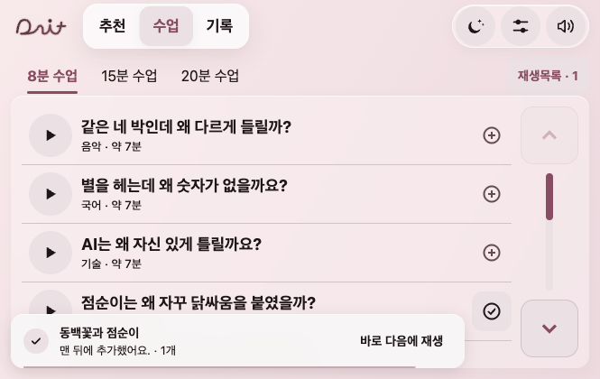
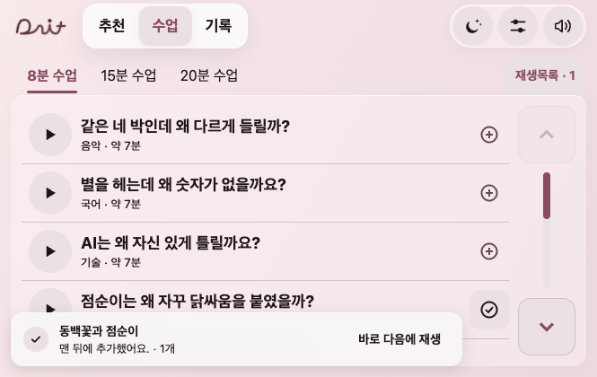
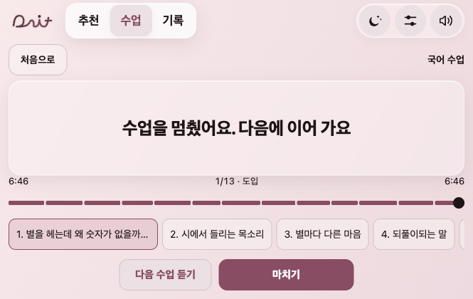
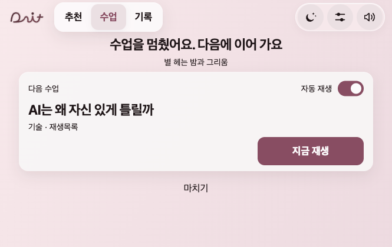
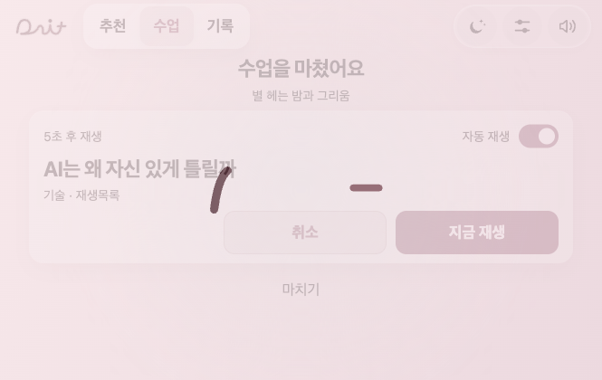

# 출발 예약 제거·재생목록과 시리즈

최신 동작은 이 문서의 **2026-11-10 종료 화면·제작자 시리즈** 절을 따른다. 이전 사용자 시리즈 저장·즉시 자동 전환 기록은 변경 이력이다.

2026-11-09 · 이지민. 기준 main 37f19b7(팀원 배속 유지 수정 포함), 작업 브랜치 codex/series-playlist.

사용자 결정: 출발 시 듣기 예약은 필요 없다. 시리즈 순서·선택 가능한 자동 재생·재생목록 추가를 준비한다. **시리즈 구성은 나중에 정하고 기능만 준비한다**는 답을 반영해 공식 시리즈 자료는 빈 배열로 둔다. 기존 여섯 수업 사이의 선수 관계를 임의로 지정하지 않는다.

## 기성 사례와 선택

- [Apple Podcasts 재생 대기](https://support.apple.com/guide/podcasts/choose-which-episodes-play-next-pod64adbf9aa/1.1.0/mac/27): Play Next는 맨 앞, Add to Queue는 맨 뒤에 넣고 목록을 편집한다.
- [Pocket Casts Up Next](https://support.pocketcasts.com/knowledge-base/up-next-continuous-playback/): 직접 담은 목록과 자동 재생을 구분하고 Play Next/Play Last 및 삭제를 제공한다.
- [Apple Podcasts 회차 순서](https://support.apple.com/en-kw/guide/iphone/iph4003ecb12/ios): 프로그램의 회차 순서에 따라 남은 회차를 재생한다.
- 다잇은 **+ 한 번으로 맨 뒤에 추가**한다. 토스트의 **바로 다음에 재생**을 누르면 방금 넣은 항목만 다음 순서로 옮긴다. 매번 두 동작을 고르는 선택창은 제거했다. 재생목록은 현재 수업과 다음 목록을 구분한다. 직접 고른 목록이 시리즈의 자동 다음 편보다 우선한다. 위/아래 버튼과 삭제를 제공하며 44px 이상 터치를 유지한다.

## 구현

- 출발 예약 상태·30분 타이머·주행 시작 자동 실행·예약 점 깜빡임·예약 메뉴를 제거했다. 목록에 수업을 담아도 출발만으로 재생하지 않는다.
- `dait-playlist.js`는 DOM 없는 목록/시리즈 모델이다. `dait-app-playlist.js`가 수업·내비·기기 저장과 연결하고, `dait-queue-ui.js`가 기존 유리 설정창으로 편집한다. 기존 시간 이동·라이트/다크별 배색·핸들 조작·음량·이어 듣기·기록을 유지한다.
- 다음 수업 자동 재생(기본 켜짐)을 끄면 현재 수업 뒤에 멈추며 목록은 보존한다. 자연 종료에서만 다음을 시작하고 사용자 종료·일시정지·통화 등 시스템 중단·도착 처리에서는 목록을 소비하지 않는다. 남은 시간에 첫 항목이 안 들어가면 다음 이동을 위해 남긴다. 빈 목록/시리즈가 아닌 일반 긴 이동은 기존 추천 교시/휴식을 유지한다.
- 자동 전환이나 수업 선택은 목록의 사용한 항목만 소비한다. 중복 수업을 명시적으로 넣을 수 있고 이미 소비한 항목을 다시 계획하지 않는다. 듣던 수업의 +에서 넣은 이어 듣기 의도는 저장하며, 유효한 재개 지점이 있으면 잇는다. 재시작·모드 변경 후 목록과 설정을 복원하지만 사용자 동작 없이 소리를 시작하지 않는다.
- 이전 편이 미완주이면 주차 중에 먼저 듣기/이 수업 바로 듣기를 제시한다. 강제하지 않으며 주행 중에는 선택 모달을 띄우지 않는다. 이미 듣는 같은 수업으로 복귀할 때는 다시 묻지 않는다.
- 재생목록을 내 시리즈로 저장할 수 있다. 공식 자료와 내 시리즈를 구분해 공식 자료를 사용자 저장소에 복제하지 않는다. 팀의 공식 구성은 `dait-series.js`에 나중에 넣는다.
- 시리즈 순서대로 듣기와 시리즈 연결 안내는 각각 켜고 끈다. 앞편을 실제 마쳤고 시간 예산이 허용되는 원래 판에서만 기존 복습 음원을 연결한다(짧은 판의 기존 복습 생략 규칙 유지). 상관없는 수업을 지난 시간이라고 붙이지 않는다. 별도의 시리즈 예고 대본·음원은 아직 만들지 않았다.
- 향후 공식 시리즈의 `outros`에 수업 ID별 `{clip:'lesson/음원ID',seconds:실제길이,text:'화면문구'}`를 넣으면 같은 시리즈의 다음 편을 이어 들을 때 정리 뒤에 붙는다. 현재 다음 편·설정·도착 상태와 맞지 않으면 건너뛴다. 제출 전 검사 도구는 잘못된 순서/없는 예고 음원 참조를 차단한다. 실제 시리즈 구성/예고 음원 납품과 기능 준비를 구분한다.

## 검증

- Node **165개 통과**. 출발 예약 폐기에 맞춰 해당 시험 9개를 제거하고 목록 순서·중복·저장/손상·직접 목록 우선·자동 재생 끄기·자연 종료/명시 종료·일시정지/중단·도착/짧은 ETA·선수 안내·실제 앞편 복습·예고 연결 자리·없는 예고 음원 차단을 시험했다. 기존 긴 이동·핸들·내비·배속 검사도 통과했다.
- 현재 JS18개 문법 검사, 여섯 수업의 **282개 음원 파일 누락0**, 공식 시리즈0(의도한 상태).
- Chrome **665×420·1000×632·420×640**, 라이트/다크와 초록 사용자 배경 포함7조합×7화면=**49화면**. 실제 표시 글자 픽셀 대비 미달0·가로 넘침 없음. 추가/다음/순서 이동/삭제/내 시리즈 저장/순서 경고와 건너뛰기/설정/다시 열기/주행 차단 확인.
- 재생 중 목록을 열어 둔 채 실제 마지막 음원 종료→다음 수업→목록 소비·지금 수업 표시 갱신을 확인했다. 검사용 이미 들은 구간 설정과 마지막 음원16배속을 사용한 기술 검사이며 품질 청취가 아니다. 팀원 배속 수정37f19b7을 받은 뒤 같은 경계를 최종 재검사했다.
- Android APK 빌드·실기기·실차·배포는 이번에 하지 않았다.

## 동일 URL·상태·665×420 전후

URL은 `http://127.0.0.1:8796/dait-preview.html?app=1&rev=main-99e47fe`, 기본 라이트·8분·빈 진도/목록·스크롤0이다. URL의 이전 커밋 표시는 캡처 조건이고 실제 소스는 현재 작업 브랜치다.

| 전 | 후 |
|---|---|
|  |  |

추가 선택창은 아래 후속 변경으로 대체했다.

시리즈 관련 그림은 분리된 브라우저의 **시험용 시리즈**다. 실제 배포 자료에 포함한 시리즈가 아니다.

## + 간편 추가 후속 변경

사용자 요청에 따라 기본 동작을 맨 뒤 추가로 고정했다. 토스트는 약 4.5초 동안 `맨 뒤에 추가했어요.`와 `바로 다음에 재생` 버튼을 보여 준다. 키보드로 실행 버튼에 초점을 두면 닫힘을 유예한다. 순서 변경 후 `바로 다음에 재생하도록 바꿨어요.`로 알린다. 현재 수업을 재시작하지 않고 항목을 복제하지 않는다.

같은 수업을 여러 번 넣어도 고유 항목 키로 방금 넣은 항목만 옮긴다. 연속 추가의 오래된 토스트, 이미 소비/삭제된 항목, 주행 전환 뒤의 동작은 목록을 바꾸지 않는다. 주행으로 전환하면 실행 버튼이 있는 토스트도 닫는다. 저장 실패는 화면에서만 유지된다고 알린다.

검증: Node **168개 통과**. Chrome에서 기본 추가/중복 항목 이동/오래된 버튼 무효화/주행 차단을 확인했다. **320·420·665px** 너비에서 토스트 넘침이 없고 실행 버튼 높이는 44px이다. 기존 49화면 검사는 앞선 기능 검증 기록이며 이번 후속 변경으로 다시 수행한 수치가 아니다. Android 빌드·실차·배포는 미실시다.

같은 URL·665×420·라이트·빈 목록에서 동백꽃의 +를 누른 직후다. 이전은 선택 대기 상태, 이후는 즉시 추가된 상태다.

| 전: 선택창 | 후: 즉시 추가 + 토스트 |
|---|---|
|  |  |

## 추가 확인과 알림 모션 마감

검은 독립 박스를 기존 배색을 따르는 하단 유리 알림으로 바꿨다. 방금 담은 수업명·목록 개수를 보여 주고, 누른 +는 750ms 체크로 바뀐다. 다음 추가는 알림을 쌓지 않고 제자리에서 내용·수명선을 갱신한다. 진입210ms·내용교체130ms·종료140ms이며 4.5초 뒤 닫힌다. 줄어드는 선은 남은 표시 시간을 알린다. 터치 포인터가 남아 알림이 계속 뜨지 않도록 포인터 호버로 타이머를 멈추지 않는다. 키보드 초점은 유예하고, 모션 줄이기/주행에서는 이동 모션과 수명선 모션을 끈다.

차량 너비에서는 + 열을 가리지 않게 오른쪽 폭을 비우고, 480px 이하에서는 전체 너비를 사용한다. 320·420·665px 너비에서 알림60px·실행버튼44px·넘침 없음. Chrome 실제 연속 추가의 제목/개수·두 버튼 체크, 자동 사라짐·모션 줄이기 확인. Node168 통과. 실차 프레임 속도는 측정하지 않았다.

| 전: 독립 검은 박스 | 후: 앱 배색과 연결·추가 확인 |
|---|---|
|  |  |

## 팀 최신본 b6f5b19 동시 반영

알림 작업 중 main에 올라온 배경음·숙제 제거·매미 대본 및 소수 이야기 순서 변경을 보존해 작업 브랜치로 받았다. 기존의 복습 재사용 구현/위 기록은 최신 팀 결정으로 대체돼 지난 수업 복습을 붙이지 않는다. 팀이 수업 자료에 명시한 series/part 순서만 목록 모델에서도 읽으며 임의 순서는 만들지 않는다. 별도 공식 시리즈 파일은 빈 상태이며 수업 자료의 소수 이야기 순서를 사용한다. 두 시리즈 설정 진입점은 같은 기기 저장값을 사용한다.

새 main의 매미27조각은 아직 음원이 없어 전체 제출용 음원 검사에서 차단된다(309개 중27개). 이 음원 제작·납품은 이번 디자인 수정 범위 밖이며 완료로 표시하지 않는다. 기존282개 음원과 팀의 배경음 파일은 보존했다.

2026-11-10 최종: 최신 main 병합 후 Node172개 통과. Chrome에서 자동종료·연속 추가·키보드 초점 유예/실행 및 모션 줄이기를 확인했다.

## 2026-11-10 알림 수명선 제거

줄어드는 막대가 긴박해 보인다는 사용자 피드백으로 수명선 DOM·애니메이션·스타일을 제거했다. 4.5초 동안 정적으로 머문 뒤 위치 이동 없이320ms 동안 옅어져 닫힌다. 추가 체크·제목/개수 갱신·키보드 초점 유예·바로 다음 재생은 유지했다. Node172 통과,Chrome 실제 표시 중 알림 애니메이션0·수명선0·연속 추가 갱신·자동 종료 확인.

| 전 | 후 |
|---|---|
|  |  |

## 2026-11-10 종료 화면·제작자 시리즈

사용자 요청1~4와 확인 답(설정에서 처음부터 듣기 제거)을 반영했다.

- 종료 후 작동하지 않던 수업 구간 바와 번호 버튼을 제거했다. 재생 중 초/분 이동·시간 탐색은 기존 전체화면 플레이어에서 유지한다.
- 종료 화면에 실제 다음 수업과 자동 재생 스위치를 둔다. 자연 종료하면5초 뒤 다음 수업을 시작하며 취소·지금 재생을 고를 수 있다. 취소는 이번 전환만 멈추고 목록을 보존하며, 스위치는 기기에 저장된다. 설정/목록에는 자동 재생 스위치를 중복 배치하지 않는다.
- 타이머는 실제 마감 시각으로5→4→3→2→1을 계산한다. 목록 편집/삭제·화면 이탈·수동 종료·새 수업 시작·오디오 중단·도착/부족한 내비 시간에는 오래된 예약을 취소한다. 실행 직전 같은 항목과 시간 예산을 재확인하며 하나만 소비한다. 주행 화면에도 취소·지금 재생을 제공한다. 긴 이동의 기존 쉬는 시간·교시 조립을 유지하고 사용자가 쉬는 시간을 직접 넘기면 즉시 잇는다.
- 사용자가 만드는 것은 재생목록이다. 시리즈로 저장 기능·이름 입력·사용자 시리즈 복원/저장을 제거했다. 제작자 catalog와 수업 series/part만 읽는다. 기존 목록 항목과 설정 저장은 유지한다. 시리즈 순서대로 듣기·연결 안내는 기본 켜짐으로 설정에 모으고, 먼저 듣기 안내를 건너뛰거나 재생 중 시간 이동으로 넘길 수 있다.
- 설정에서 처음부터 듣기를 제거했다. 색상·초/분 이동·배속은 유지한다.

검증: Node175개 통과. 추가한 검사에서 5초 전 목록 미소비/정확히 다음 한 편 소비,취소·끄기·도착·목록 변경·화면 이탈·수동 종료·오디오 중단 시 실행 차단을 확인했다. 제작자 시리즈만 복원하는 검사로 이전 내 시리즈 시험을 변경했다. 기존 긴 이동 시험은 새 5초 전환의 시간을 명시적으로 진행시키며 검사한다. Chrome 실제5초 전환·취소·즉시 재생·스위치 끔/다시 켬/새로고침 저장·주행 취소·설정/목록 항목을 확인했다. 665×420·1000×632·420×640 라이트/다크6조합에서 종료 화면 가로 넘침0·버튼44px 이상·계산 텍스트 대비6.15 이상 확인(실차 성능/전체 앱 픽셀 검사 아님). Android 빌드·실기기·배포 미실시.

같은 URL·665×420·라이트·별 헤는 밤을 수동 종료한 상태이며, 자연 종료의5초 화면은 별도 그림이다.

| 전: 비활성 진행바/구간 | 후: 다음 수업 조작 |
|---|---|
|  |  |

