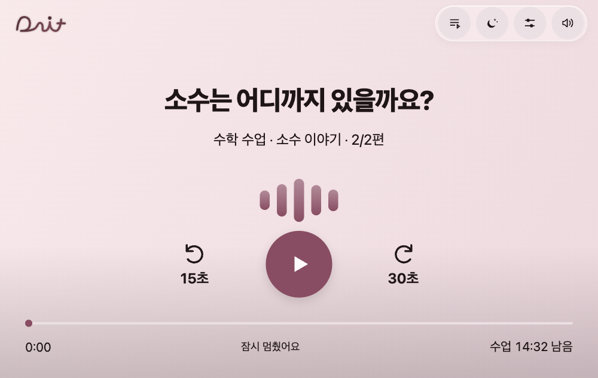
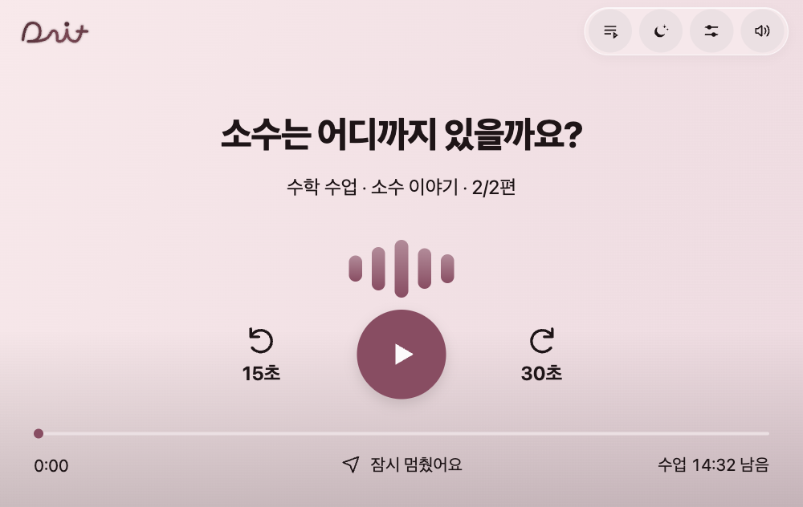
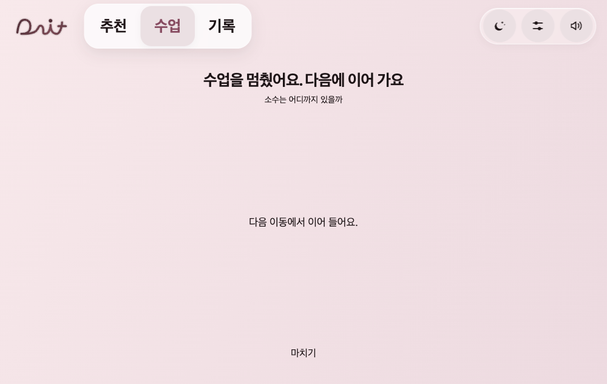
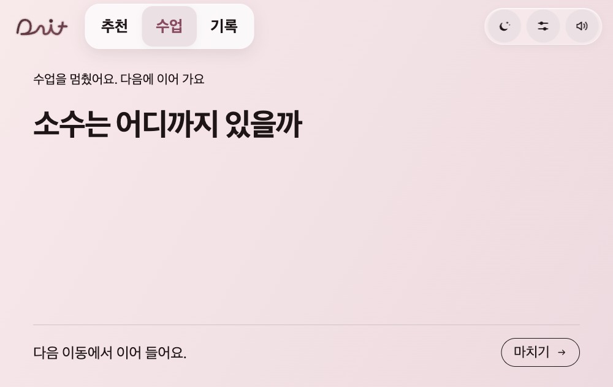

# 재생 하단·종료 화면 호라이즌 적용

사용자 최종 첨부를 기준으로 반영했다. 재생 바 아래는 경과 시간 왼쪽·내비 모양 아이콘과 안내 중앙·남은 시간 오른쪽의 한 줄이다. 이전 비교 시안의 좌측 아래 안내/전체시간 추가는 채택하지 않는다. 바 위 제목·과목·파형·15/30초·재생 버튼과 사용자 배색 저장/자동 배색은 변경하지 않았다.

종료 화면은 기존 시안대로 좌측 정렬·콘텐츠명을 주제목·작은 종료 안내·하단 구분선과 우측 마치기 버튼을 적용했다. 별도 색상이나 새 배경 음영을 추가하지 않는다. 실제 다음 수업과5초 자동 재생/취소/지금 재생은 유지하며 다음 수업이 있을 때도 버튼이 화면 안에 보인다.

검증: Node176개 통과. Chrome665×420·1000×632·420×640의 라이트/다크6조합에서 재생 하단과 종료 화면의 가로 넘침0·계산 텍스트 대비4.5 미만0을 확인했다. 중앙 안내의 중심은 진행 바 중심과 동일(오프셋0)이다. 1000×632에서 변경 전/후 제목·파형·재생 조작 그룹·주재생 버튼의 위치/크기가 각각 정확히 일치한다. 종료 콘텐츠명은 기본665에서34px,1000에서50px,420에서30px이며 마치기는44px 이상이다. 기존시간이동·5초 전환·주행정책은 기존 기능 시험으로 확인했다. Android빌드·실기기·배포는 미실시.

동일URL http://127.0.0.1:8796/dait-preview.html?app=1&rev=main-99e47fe,1000×632·라이트·소수15분·일시정지 상태 전후다. 종료는 같은 수업을 수동 종료한 상태다.

| 전 | 후 |
|---|---|
|  |  |
|  |  |
